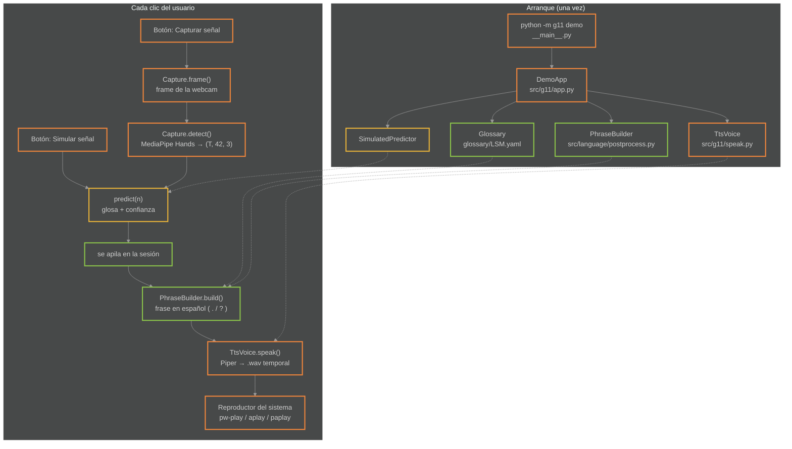
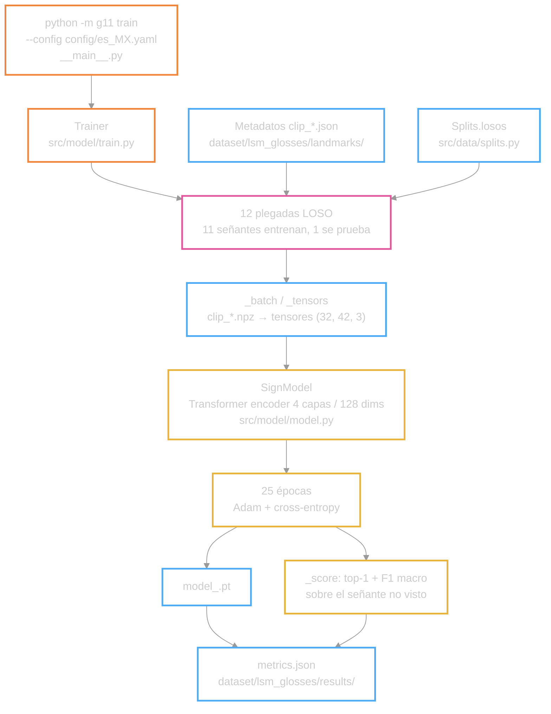

# Guía para contribuir a SignVoice

**Para quien llega por primera vez al repo.** Esta guía explica qué es el proyecto,
qué instalar (Windows y Linux), cómo arrancar todo, cómo está construido el código y
cómo se trabaja aquí. Si vas a escribir código, lee también `AGENTS.md` (las reglas
duas del proyecto); si quieres entender el *por qué* de cada decisión, `.backlog/`.

---

## 1. Qué es SignVoice

SignVoice reconoce **señas aisladas de la Lengua de Señas Mexicana (LSM)** desde la
webcam y las convierte en una **frase en español hablada** (voz offline). Es una
práctica universitaria de **aprendizaje supervisado + visión por computadora**: se
evalúa el proceso de ML (datos, modelo, métricas honestas), no el estado del arte.

El pipeline completo, de entrada a salida:

```
webcam → MediaPipe Hands (42 landmarks × 2 manos)
       → Normalizer: relativos a la muñeca, ventana fija (32, 42, 3)
       → Transformer encoder (4 capas, 128 dims, token de clasificación)
       → glosa LSM (10 glosas)
       → Glossary + plantillas deterministas → frase en español
       → Piper (voz offline, es_AR)
```

El núcleo es una función pura `frames → glosas → frase`. La futura API con cuentas
(fase 4) la **llamará**, no la reescribirá: el núcleo nunca importa HTTP, sesiones
ni base de datos.

## 2. Requisitos y herramientas

| Herramienta | Para qué | Windows | Linux |
|---|---|---|---|
| **`uv`** | Instala Python 3.11, las dependencias y las herramientas de desarrollo (`ruff`, `ty`, `pytest`) | Sí | Sí |
| **Git** | Control de versiones | Sí | Sí |
| **7-Zip / `p7zip`** | Solo si vas a descargar el dataset (descomprime el 7z de Zenodo) | 7-Zip | `p7zip-full` |
| **Webcam** | Para la demo en vivo | Sí | Sí |
| **GPU NVIDIA (CUDA)** | *Opcional*: entrena mucho más rápido; sin GPU todo corre en CPU | Opcional | Opcional |

No necesitas instalar Python a mano: `uv` trae y gestiona la versión correcta
(≥ 3.11) automáticamente.

### Instalar `uv`

**Windows** (PowerShell):

```powershell
powershell -c "irm https://astral.sh/uv/install.ps1 | iex"
```

**Linux / macOS** (bash):

```bash
curl -LsSf https://astral.sh/uv/install.sh | sh
```

Después de instalar, abre una terminal nueva (o ejecuta `source` del script que
indica `uv`) y verifica:

```bash
uv --version
```

### 7-Zip (solo para el dataset)

- **Windows:** instala <https://7-zip.org> (el binario `7z` debe estar en el PATH).
- **Linux:** `sudo apt install p7zip-full` (Debian/Ubuntu) o el equivalente de tu
  distribución.

## 3. Instalación del proyecto

```bash
# 1. Clonar
git clone <url-del-repo> sign-lang-traductor
cd sign-lang-traductor

# 2. Crear el entorno virtual con dependencias + herramientas de desarrollo
uv sync --all-groups

# 3. Verificar que los modelos locales estén (voz Piper + .task de MediaPipe)
uv run python scripts/download_models.py
```

Opcional, solo si vas a **entrenar** el modelo (≈ 2.7 GB de descargas):

```bash
# 4. Dataset LSM Glosses (requiere 7-Zip; re-ejecutable: salta lo ya descargado)
uv run python scripts/download_lsm_glosses.py

# 5. Extraer landmarks de los videos → dataset/lsm_glosses/landmarks/
uv run python scripts/extract_video_landmarks.py
```

### Verificar que todo funciona

```bash
uv run ruff check .     # lint
uv run ty check .       # tipado
uv run pytest -q        # 30 tests, sin cámara, red ni GPU
uv run python -m g11 demo   # abre la demo en http://127.0.0.1:7860
```

Con esos cuatro comandos en verde, tu entorno está listo.

## 4. Cómo está construido el proyecto

### Capas (top → abajo; un módulo solo importa de capas inferiores)

| Capa | Paquete | Módulos | Rol |
|---|---|---|---|
| L5 · Aplicación | `src/g11/` | `app` · `speak` · `__main__` | Demo Gradio, voz offline, CLI |
| L4 · Modelo | `src/model/` | `model` · `train` | Transformer encoder, entrenamiento LOSO, métricas |
| L3 · Visión | `src/vision/` | `capture` | Webcam → *landmarks* (MediaPipe Tasks) |
| L2 · Datos | `src/data/` | `splits` | Splits **LOSO** por señante (lógica pura) |
| L1 · Lenguaje | `src/language/` | `glossary` · `postprocess` | Glosas → frase en español (YAML) |
| L0 · Características | `src/features/` | `landmarks` · `normalize` | Ventana `(32, 42, 3)` relativa a la muñeca |

### Estructura de directorios

```
src/       los 11 módulos del pipeline (6 paquetes, una clase de negocio c/u)
glossary/  LSM.yaml — el vocabulario (10 glosas) como DATO, no como código
config/    es_MX.yaml — config pre-registrada de entrenamiento
models/    .task de MediaPipe y voz Piper (demo sin internet)
dataset/   lsm_glosses/ (descargado, no versionado): videos, landmarks, resultados
scripts/   jobs de un solo uso: descargas y extracción de landmarks
tests/     espejo 1:1 de src/ (tests/<pkg>/test_<módulo>.py)
docs/      esta guía, el informe y el anexo de investigación
.backlog/  historias, plan y decisiones (backlog.md, plan.md, stories/)
```

### Conceptos clave para leer el código

- **Glosa:** la unidad mínima de una lengua de señas (una "palabra" aislada).
  Las 10 glosas pilotas: HOLA, SI, NO, GRACIAS, CASA, AMIGO, NOS_VEMOS,
  POR_FAVOR, DOCTOR, AYUDA.
- **Señante:** la persona que produce la seña.
- **Landmarks:** los 21 puntos de cada mano que detecta MediaPipe; dos manos
  apiladas dan un vector de 42 × 3 coordenadas por frame.
- **Clip:** una secuencia normalizada `(32, 42, 3)` guardada en `clip_<id>.npz`
  con su `clip_<id>.json` (glosa, señante, frames).
- **LOSO (Leave-One-Señante-Out):** se entrena con 11 señantes y se evalúa con el
  12.º, que el modelo nunca vio. Así las métricas miden generalización a
  personas nuevas, no memorización. `src/data/splits.py` es el único lugar donde
  vive esa lógica.
- **Idioma como dato:** `config/*.yaml` + `glossary/<lengua>.yaml`. Nunca hay
  `if language == …` en la lógica.

## 5. Flujo de ejecución

El proyecto tiene **tres flujos de ejecución** independientes. Cada uno se
describe con su comando, la cadena de clases que participa y qué produce en
disco o en pantalla.

> Los diagramas Mermaid siguen la convención del repo (`docs/README.md`):
> tema oscuro con texto claro, color **solo en el borde** y sin relleno.
> Colores: naranja = entrada/salida (cámara, voz, CLI), amarillo = núcleo de
> la IA, verde = post-proceso lingüístico / salida en español, azul = datos,
> rosa = conjunto de prueba ciego (LOSO). Si editas un diagrama, revalidarlo
> en <https://mermaid.live> antes de exportarlo.

### 5.1 Demo (`python -m g11 demo`)



Las líneas punteadas muestran qué componente del arranque usa cada paso del
clic. La webcam (`Capture`) solo participa del botón "Capturar señal".

Paso a paso:

1. **Arranque.** `src/g11/__main__.py` (`demo()`) crea `DemoApp` con
   `glossary/LSM.yaml` y lanza Gradio en `http://127.0.0.1:7860`.
2. **Carga inicial** (`DemoApp.__init__`, `src/g11/app.py`): lee el glosario
   (`Glossary`), arma `PhraseBuilder` con sus palabras y marcadores, crea el
   predictor simulado y la voz.
3. **Cada clic del usuario** dispara una de dos cadenas:
   - **"Simular señal"** → `step()`: `SimulatedPredictor.predict(n)` devuelve una
     glosa determinista (semilla + índice, misma glosa siempre para el mismo
     índice) y la UI la marca como *"simulado"*.
   - **"Capturar señal (webcam)"** → `capture_step()`: `Capture.frame()` toma un
     frame de la webcam; `Capture.detect(frame)` corrie MediaPipe Hands y guarda
     los 42 × 3 *landmarks*; después sigue la misma cadena simulada (el modelo
     real reemplazará al predictor sin tocar el resto).
4. **Glosas → frase.** La glosa se apila en la lista de la sesión y
   `PhraseBuilder.build(glosas)` une las palabras en español del YAML y cierra
   con `.` o `?` según si alguna glosa es marcador de pregunta.
5. **Voz.** `TtsVoice.speak(frase)` sintetiza con Piper
   (`models/es_AR-daniela-high.onnx`) un `.wav` temporal y lo reproduce con el
   primer reproductor disponible (`pw-play`, `aplay`, `paplay`); si no hay
   reproductor o falla, la demo sigue en silencio (solo avisa en el log).
6. **Salida en pantalla:** glosa, confianza, frase en español y estado.

### 5.2 Preparación de datos (una vez, sin GPU)

```
download_lsm_glosses.py → dataset/lsm_glosses/ (videos + manifest.json)
extract_video_landmarks.py → dataset/lsm_glosses/landmarks/
    (120 × clip_<glosa>_<señante>.npz + .json) + splits.json
```

1. **Descarga.** `scripts/download_lsm_glosses.py` baja el 7z de Zenodo
   (registro 18330565), verifica el md5 y lo extrae con 7-Zip a
   `dataset/lsm_glosses/`. Es re-ejecutable: salta lo ya descargado.
2. **Extracción.** `scripts/extract_video_landmarks.py` (`VideoExtractor`)
   recorre los 120 videos piloto (10 glosas × 12 señantes) y por cada video:
   - `Capture.detect_video` — MediaPipe en modo video (los timestamps deben
     crecer de forma estricta entre videos);
   - `Landmarks.stack` — apila las 2 manos → `(T, 42, 3)`;
   - `Normalizer.forward_fill → resample → normalize` — completa frames sin
     mano, re-muestrea y centra en la muñeca → ventana fija `(32, 42, 3)`;
   - escribe `clip_<glosa>_<señante>.npz` (landmarks) y `.json` (glosa,
     señante, nº de frames).
3. **Splits.** `Splits.losos` (`src/data/splits.py`) genera `splits.json` con
   12 plegadas: en cada una, un señante queda fuera como conjunto de prueba.

### 5.3 Entrenamiento (`python -m g11 train --config config/es_MX.yaml`)



El bucle por plegada es `FOLDS → BATCH → MODEL → EPOCHS` y se repite 12
veces (una por cada señante que queda fuera).

1. **Arranque.** `__main__.py` (`train()`) lee `config/es_MX.yaml`
   (glosas, rutas, épocas, semilla, dispositivo) y construye `Trainer`
   (`src/model/train.py`).
2. **Plegadas.** `Trainer.folds()` lee los metadatos `clip_*.json` y usa
   `Splits.losos` para formar 12 plegadas: 11 señantes entrenan, 1 se prueba.
3. **Cada plegada** (`Trainer.fit`):
   - carga los `.npz` a tensores (`_batch`/`_tensors`);
   - entrena `SignModel` (`src/model/model.py`, Transformer encoder) 25 épocas
     con Adam + cross-entropy;
   - guarda los pesos en `model_<señante>.pt`;
   - puntúa al señante que **nunca vio**: top-1 y F1 macro.
4. **Resultado.** `Trainer.run()` escribe `dataset/lsm_glosses/results/metrics.json`
   (métricas por señante, curva de pérdida y latencia en ms) y los imprime por
   consola.

**Regla que une los tres flujos:** el núcleo es una función pura
`frames → glosas → frase`. La demo, el entrenamiento y la futura API de
servidor son *llamadores* del núcleo; nunca al revés.

## 6. Comandos del día a día

```bash
uv run python -m g11 demo          # demo Gradio + webcam + voz (offline)
uv run python -m g11 train --config config/es_MX.yaml   # entrenamiento LOSO
uv run pytest -q                   # toda la batería de tests
uv run pytest tests/language/ -q   # solo una capa
uv run ruff check . && uv run ty check .   # puertas de calidad
```

El entrenamiento escribe `dataset/lsm_glosses/results/metrics.json` (top-1 y F1
macro por señante, curva de pérdida y latencia). La config vive en
`config/es_MX.yaml`: incluye `device: cuda`; **en una máquina sin GPU cámbiala a
`cpu`** antes de entrenar.

## 7. Reglas duras de código (resumen de `AGENTS.md`)

- **Archivo ≤ 100 líneas** (60 sugeridas, excluyendo docstrings); función
  **≤ 9 líneas**. Si crece: dividirlo, no subir el límite.
- **Orientado a objetos**: la lógica de negocio vive en clases; un módulo = una
  clase de negocio; sin herencia, fábricas ni inyección de dependencias.
- **`src/` ≤ 12 módulos**. Jobs de un solo uso van en `scripts/`, nunca en `src/`.
- **Lógica pura** para `normalize`, `splits`, `postprocess` y métricas: sin I/O,
  testeable con `pytest` sin cámara, red ni GPU.
- **Regla de dos:** una abstracción solo aparece cuando ya hay dos usos reales.
- **Regla de borrado:** lo que la demo no consume se elimina.
- **Sin internet en la demo:** nada de descargas en runtime.
- **Código en inglés** (identificadores, comentarios, docstrings, logs, tests);
  **español solo en datos visibles al usuario** (frase, interfaz, TTS, valores de
  `glossary/LSM.yaml`).
- **Tests con docstring en inglés** que explica qué prueba y por qué importa.
- **Docstrings Google-style** en clases y métodos del núcleo (`Args:` / `Returns:`).

## 8. Cómo contribuir

1. **Una historia a la vez**, tomada de `.backlog/backlog.md` (el orden de fases
   está en `.backlog/plan.md`). Lee la ficha de la historia en
   `.backlog/stories/` antes de tocar código.
2. **Un commit por historia**, con mensaje **conventional**
   (`feat:`, `fix:`, `refactor:`, `docs:`, `test:`, …).
3. **Puertas de calidad verdes** en cada commit: `ruff check .`, `ty check .`,
   `pytest -q`. Si editas `pyproject.toml`, también
   `uv run tombi format --check pyproject.toml`.
4. **Tests espejo 1:1**: el test de `src/<pkg>/<módulo>.py` vive en
   `tests/<pkg>/test_<módulo>.py`.
5. **No comitear datos**: videos, `*.npz`, `*.pt`, `dataset/` y `docs/investigacion/`
   están fuera de git.
6. El informe (`docs/informe/entrega1_informe.md`) es material impreso: **no
   reformatearlo** sin avisar.

## 9. Problemas comunes

| Síntoma | Causa probable / arreglo |
|---|---|
| `uv: command not found` | Terminal vieja: reabrela o carga el script de instalación de `uv`. |
| `device: cuda` falla en CPU | Edita `config/es_MX.yaml` → `device: cpu`. |
| `download_lsm_glosses.py` falla al extraer | Falta 7-Zip en el PATH (sección 2). |
| La demo no abre la cámara | Permisos del sistema a la webcam; prueba la URL en el mismo navegador donde diste permiso. |
| `ty` avisa de librerías de terceros | Esperado: `mediapipe`/`pyttsx3` no traen stubs; la config de `ty` ya los ignora. No "arregles" eso. |
| Entrenamiento lento | Normal en CPU; 12 plegadas × 25 épocas sobre 110 clips es pequeño. |

## 10. Lecturas de referencia

| ¿Quieres… | Ve a… |
|---|---|
| Entender el problema (estado del arte, datasets, marco legal) | `docs/investigacion/` (índice en `docs/README.md`) |
| Ver qué falta y en qué orden | `.backlog/backlog.md` y `.backlog/plan.md` |
| Conocer las reglas duras completas | `AGENTS.md` |
| Entender el informe que se entrega | `docs/informe/entrega2_borrador.md` |
