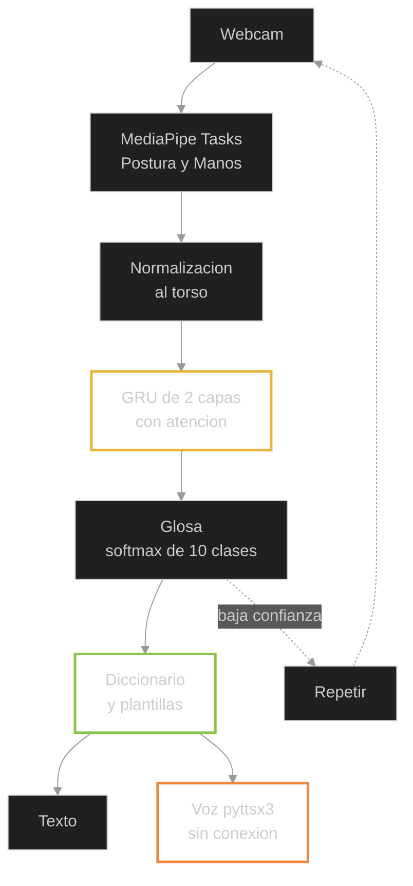

# SignVoice: reconocimiento de señas y conversión a voz

### Traductor asistido por visión por computadora y aprendizaje supervisado para la Lengua de Señas Mexicana

**Entrega 1:** introducción, objetivos, marco teórico y marco referencial. La sección V
(Ingeniería) se inicializa aquí y se completa en la segunda entrega.

---

## Portada

> **Universidad o Departamento:** ______
> **Asignatura:** Práctica de IA
> **Grupo:** 11
> **Profesor o profesora:** ______
> **Fecha:** 10 de noviembre de 2026
> **Ciudad y Estado:** ______
>
> **Integrantes** (matrícula: ______):
>
> 1. Camacho Cabrera Vladimir, integración y modelado
> 2. León Flores Luis Santiago, datos y captura
> 3. Mangudo Betancur Carlos Junior, modelado y experimentos
> 4. Paz Colque Willy Samuel, post-proceso lingüístico
> 5. Romero Cruz Juan Ignacio, síntesis de voz, interfaz y demo
> 6. Tellez Angulo Jose Manuel, ética y validación externa
> 7. Totora Huanca Franz Gabriel, documentación y calidad

## Índice

I. Introducción. II. Objetivos. III. Marco teórico. IV. Marco referencial. V. Ingeniería
(inicializada). VI. Referencias.

Índice de tablas y figuras: Tabla 1, objetivos específicos y su verificación. Tabla 2, criterios de
éxito medibles. Tabla 3, conjuntos de datos de LSM. Figura 1, flujo del sistema propuesto.

## Lista de abreviaturas

Instituciones y lengua:

- **OMS:** Organización Mundial de la Salud.
- **ONU:** Organización de las Naciones Unidas.
- **CONADIS:** Consejo Nacional para el Desarrollo y la Inclusión de las Personas con Discapacidad.
- **LSM:** Lengua de Señas Mexicana.

Modelos y tareas:

- **SLR:** reconocimiento de lengua de señas, del inglés *sign language recognition*.
- **SLT:** traducción de lengua de señas, del inglés *sign language translation*.
- **GRU:** unidad recurrente con puerta, del inglés *gated recurrent unit*.
- **LSTM:** red de memoria a largo plazo, del inglés *long short-term memory*.
- **ST-GCN:** red convolucional espacial y temporal sobre grafos.
- **CTC:** clasificación por conexión temporal, del inglés *connectionist temporal classification*.

Evaluación:

- **LOSO:** validación que deja fuera a un señante en cada pliegue, del inglés *leave-one-signer-out*.
- **F1:** media armónica entre precisión y recobro; **F1 macro** es el promedio sin ponderar de la F1 de
  cada clase.

Datos y licencias:

- **CES:** *Computación, Electrónica y Sistemas*, sede académica del conjunto Espejel.
- **MSLR:** *Mexican Sign Language Recognition*, conjunto de datos de LSM de 29 clases.
- **WLASL:** *Word Level American Sign Language*, conjunto de datos de 2 000 signos.
- **Creative Commons Atribución (CC BY):** licencia que permite usar y compartir la obra citando el
  origen.
- **MIT:** licencia libre del Instituto de Tecnología de Massachusetts.

Claves internas:

- **OE:** objetivo específico.
- **P:** pregunta de investigación.

---

# I. INTRODUCCIÓN

## 1.1 Planteamiento del problema

La Organización Mundial de la Salud (OMS) estima que 430 millones de personas, el 5 % de la humanidad,
necesitan rehabilitación audiológica (OMS, 2024). La Organización de las Naciones Unidas (ONU) calcula
unos 70 millones de personas sordas y registra más de 300 lenguas de señas, ninguna universal (Naciones
Unidas, 2021). En México, la Lengua de Señas Mexicana (LSM) es lengua nacional reconocida desde 2005
(CONADIS, 2019) y tiene estructura lingüística propia (Cámara de Diputados, 2011); la escasez de
intérpretes limita la salud, la justicia y la educación (ITESO, 2024).

El problema es de asimetría lingüística: la mayoría habla español y desconoce la LSM. Un traductor de
señas a texto, y de texto a voz, permitiría comunicarse sin intérprete en contextos de bajo riesgo. Del
video se extraen los puntos articulares de quien señala, llamados *landmarks*; se reconoce la glosa,
transcripción escrita de la seña; y el sistema la emite en voz sintética. Reconocer es difícil porque las
señas son dinámicas, hay coarticulación entre señas consecutivas y la LSM tiene gramática propia, de
modo que traducir palabra por palabra no basta.

## 1.2 Justificación

En lo social, la Convención sobre los Derechos de las Personas con Discapacidad exige garantizar la
comunicación, con reconocimiento expreso de las lenguas de señas (Naciones Unidas, 2006). En lo técnico,
la ruta de puntos articulares rinde como la ruta de píxeles, con modelos mucho más ligeros, como se
revisa en la sección 3.1. En lo científico, el estado del arte se concentra en cuatro lenguas, según la
revisión de 120 conjuntos de datos en 35 lenguas (Ni et al., 2026), y la LSM está subrepresentada, con
corpus pequeños y de captura muy controlada (Hilario-Acuapan et al., 2025). Como la mayoría de las
cifras nacionales, situadas entre el 96 y el 99 %, se obtiene entrenando y probando con la misma persona
que señala, reportar resultados en señantes no vistos es en sí un aporte.

## 1.3 Alcance, supuestos y limitaciones

El sistema reconoce, desde una cámara web, señas aisladas de diez glosas tomadas del conjunto de datos
público Espejel CES 2024 (Espejel et al., 2024), y emite la frase en español por síntesis de voz sin
conexión a internet. MediaPipe Tasks entrega los puntos articulares: 33 de la postura corporal y 21 por
mano; una unidad recurrente con puerta (GRU) de dos capas con atención temporal clasifica la glosa; un
diccionario con plantillas la convierte en español. Se asume una persona señalante de frente, a una
distancia de entre 1,5 y 3 metros, con torso y manos visibles, buena iluminación y una seña por
fragmento.

Quedan fuera, por decisión deliberada: la conversación libre, la gramática completa de la LSM, el
reconocimiento continuo y la dactilología como módulo principal. El sistema no sustituye a un intérprete
certificado: es una asistencia de bajo riesgo y nunca un canal único en decisiones médicas o legales.

Las limitaciones declaradas son cinco. Espejel aporta imágenes JPEG de unos quince cuadros por palabra,
y no video, de modo que la señal temporal es corta. El fondo y la ropa son negros y la captura se hizo a
2,5 metros, lo que puede degradar la detección del torso. Los datos vienen de un solo sitio, con
estudiantes sordos de 11 a 21 años. No se modelan las señales no manuales de la cara y la cabeza. El
dominio queda cerrado a diez glosas. Se reportará la caída de desempeño entre condiciones y no una sola
cifra.

## 1.4 Preguntas de investigación e hipótesis

P1. ¿Una GRU de dos capas con atención temporal, sobre puntos articulares normalizados, generaliza a
señantes no vistos en diez glosas aisladas, con al menos el 85 % de acierto al emitir la glosa como
primera opción?

P2. ¿Un post-proceso determinista de diccionario y plantillas produce español inteligible para una
persona firmante en al menos el 90 % de 50 casos?

P3. ¿El sistema completo opera sin conexión a internet, en un portátil común, con dos segundos de
latencia como máximo?

La hipótesis es que, con una validación que deja fuera a un señante en cada pliegue (LOSO), se alcanzará
el 85 % de acierto en señante no visto, sin cámara de profundidad y sin sensores. La meta es moderada:
una GRU de dos capas con 3 000 secuencias llegó al 97,11 % (Mejía-Pérez et al., 2022) y 121 glosas
alcanzaron una F1 de 0,94 con evaluación independiente del señante (Navarrete-López et al., 2026).

---

# II. OBJETIVOS

## 2.1 Objetivo general

Desarrollar un prototipo que, desde una cámara web, reconozca señas aisladas de LSM de diez glosas, las
traduzca a una frase de español y la emita en voz sintética sin conexión a internet, entrenado con un
conjunto de datos público etiquetado y evaluado con una validación independiente del señante.

## 2.2 Objetivos específicos

Tabla 1. Objetivos específicos y su verificación.

| Clave | Objetivo específico | Verificación |
|---|---|---|
| OE1 | Elegir las diez glosas mejor surtidas de Espejel, con traducción de persona firmante externa. | Glosario aprobado |
| OE2 | Curar y submuestrear los datos, con divisiones LOSO por señante. | Divisiones y ficha |
| OE3 | Extraer y normalizar al torso los puntos de postura y manos. | Prueba con 20 imágenes |
| OE4 | Entrenar la GRU con atención temporal y semilla fija. | F1 macro y desviación, tres corridas |
| OE5 | Convertir la glosa en español con diccionario y plantillas. | 90 % de 50 frases inteligibles |
| OE6 | Montar la demostración con cámara web, texto y voz sin conexión. | Latencia máxima de dos segundos |
| OE7 | Evaluar y reportar de forma honesta. | Precisión y F1 por pliegue, matriz de confusión |

## 2.3 Criterios de éxito medibles

Tabla 2. Criterios de éxito medibles.

| Métrica | Valor mínimo | Valor deseado |
|---|---|---|
| Acierto en la primera opción, señante no visto | 75 % | 85 % |
| F1 macro | 0,70 | 0,85 |
| Inteligibilidad, 50 casos de persona firmante | 80 % | 90 % |
| Latencia entre el fin de la seña y la voz | 2,0 s | 1,0 s |
| Cuadros por segundo de los puntos articulares | 10 | 20 |
| Caída de la F1 macro entre pliegues | 15 puntos | 10 puntos |

El criterio de selección del modelo se fija antes de experimentar: gana la mejor F1 macro promediada en
los pliegues LOSO; ante un empate de hasta un punto, la menor latencia; y el conjunto ciego se consulta
una sola vez.

## 2.4 Descripción general del sistema

Figura 1. Flujo del sistema propuesto.

La cámara entrega video; MediaPipe Tasks extrae los puntos de postura y manos, que se normalizan
respecto del torso; una GRU de dos capas con atención temporal clasifica la glosa entre diez clases con
una función softmax; y el diccionario con plantillas construye la frase que va a la pantalla y a la voz.
Si la clasificación pierde confianza, el sistema pide repetir la seña.

---

# III. MARCO TEÓRICO

## 3.1 Aprendizaje supervisado y representación de la entrada

El aprendizaje supervisado ajusta una función de la entrada a la salida con ejemplos etiquetados: aquí,
la trayectoria de puntos articulares de un fragmento y la glosa que le asignaron los autores del
conjunto de datos. Dos conceptos condicionan el proyecto: el sobreajuste, traicionero en señas porque el modelo
aprende a reconocer a la persona y no la seña, y la generalización a señantes no vistos.

La entrada admite tres representaciones. Los píxeles conservan todo el detalle, pero son costosos y
sensibles al fondo. Los puntos articulares son coordenadas de las articulaciones, ligeras e invariantes
al fondo, y permiten tiempo real en un procesador común. Los sensores portátiles quedan fuera de alcance
por su costo y por la incomodidad de quien señala. La evidencia decide: en WLASL, con 2 000 signos y más
de 100 señantes, la información de la postura rinde como la apariencia visual (Li et al., 2020).
MediaPipe Tasks entrega 21 puntos tridimensionales por mano y 33 corporales (Google Research, 2026), con
una profundidad relativa y menos confiable: de ahí la necesidad de normalizar y filtrar por visibilidad.

## 3.2 La LSM como lengua

La LSM no es español gestual: tiene fonología, morfología, sintaxis y léxico propios (Cámara de
Diputados, 2011; Hilario-Acuapan et al., 2025). Sus parámetros son la configuración de la mano, la
ubicación, el movimiento, la orientación de la palma y las señales no manuales de la cara, las cejas y
la cabeza, que funcionan como gramática al marcar la pregunta, la negación y la intensidad. Cambiar un
parámetro cambia la palabra: el modelo necesita manos y cuerpo, y añadir el codo recupera exactitud
(Hilario-Acuapan et al., 2025), de modo que un clasificador de imágenes fijas es estructuralmente
insuficiente. El léxico tiene dos capas: la dactilología, que es el alfabeto manual estático, y los
signos dinámicos; este proyecto trabaja con los signos dinámicos. La LSM varía por región y por edad, y
no coincide con la lengua de signos española ni con la argentina.

## 3.3 Niveles del campo: reconocimiento, traducción y glosas

El campo distingue el reconocimiento de lengua de señas (SLR), que va del video a una secuencia de
glosas, y la traducción de lengua de señas (SLT), que va de las señas a una frase gramatical (Ni et
al., 2026). La glosa, escrita en mayúsculas, por ejemplo YO, AYUDA y MAÑANA, es la transcripción escrita
de la seña y la única anotación escalable. La dificultad depende de dos ejes: la seña estática o
dinámica, y la seña aislada, un fragmento con una sola seña, o la continua, con señas seguidas y
coarticuladas. El reconocimiento continuo es la frontera del campo y es inalcanzable este semestre; se
empieza, como el antecedente nacional más cercano, por señas aisladas dinámicas (Navarrete-López et al.,
2026).

## 3.4 Modelos de secuencia: la opción de una GRU con atención temporal

Una seña es una serie de tiempo multivariable. La GRU es recurrencia con memoria, la variante barata de
la red de memoria a largo plazo (LSTM), y sirve para cientos o miles de secuencias: con 3 000
secuencias, una GRU de dos capas llegó al 97,11 % (Mejía-Pérez et al., 2022). La atención temporal
pondera los cuadros informativos y hace explicable el modelo: el fragmento llega como un tensor de T
cuadros por F puntos con tres coordenadas, la GRU lo recorre y un softmax clasifica entre las diez
glosas. Se descartan, por sobredimensionados, la red convolucional espacial y temporal sobre grafos
(ST-GCN), que exige grafos y más datos; el Transformer, que se sobreentrena sin preentrenamiento; y la
clasificación por conexión temporal (CTC), propia de la señal continua.

## 3.5 Evaluación creíble: separación por señante y métricas

Si los fragmentos de un mismo señante están en entrenamiento y en prueba, el modelo reconoce a la
persona, por su complexión, su ropa y su fondo, y no la seña: es fuga de datos. Los trabajos nacionales
reportan entre el 96 y el 99 % con particiones aleatorias; al exigir generalización las cifras bajan al
92 % de MSLR, a una F1 de 0,94 en el antecedente nacional y al 62,63 % de WLASL, cifras detalladas en la
sección 4.1. Toda cifra se reporta con su número de clases. De ahí salen las reglas del proyecto:
división por señante y por sesión; validación LOSO con el conjunto ciego una sola vez; acierto en la
primera opción y F1 macro, que castiga lucirse solo en las clases frecuentes; matriz de confusión; tres
semillas con media y desviación; y el criterio de selección pre-registrado en la sección 2.3.

## 3.6 Síntesis de voz sin conexión

La demostración no puede depender de internet: se usa pyttsx3, que sintetiza con la voz del sistema
operativo, sin red y bajo licencia MIT, detrás de una única función de locución que permite cambiar de
motor sin tocar el resto del sistema. Piper, con voz neuronal local en español de México, es la
alternativa de calidad; las herramientas que sintetizan en la nube quedan fuera de la demo.

## 3.7 Datos, privacidad y ética

Se trabaja con un conjunto de datos público, con licencia Creative Commons Atribución, caras desdibujadas
y consentimiento declarado (Espejel et al., 2024), en vez de grabar datos biométricos de terceros sin
marco institucional; el estándar lo fijan los precedentes nacionales, que contaron con comité de bioética
y consentimiento escrito (Hilario-Acuapan et al., 2025). Rigen cuatro principios: nada sobre nosotros sin
nosotros, porque el vocabulario y la inteligibilidad los valida una persona sorda firmante; minimización,
porque se publican el código, el glosario y los puntos articulares, y no los rostros; transparencia de
límites, con las métricas reales; y no sustituir intérpretes.

---

# IV. MARCO REFERENCIAL

## 4.1 Panorama y antecedentes nacionales en LSM

El estado del arte se concentra en cuatro lenguas, como lo muestra la revisión de 120 conjuntos de datos
en 35 lenguas (Ni et al., 2026). En LSM los antecedentes nacionales son continuos en los últimos cuatro
años. En 2022, una cámara de
profundidad con una GRU de dos capas llegó al 97,11 % con 3 000 secuencias de 30 signos (Mejía-Pérez
et al., 2022). En 2024 se publicó el conjunto abierto de 249 palabras y 31 442 imágenes de estudiantes
sordos (Espejel et al., 2024). En 2025 aparecieron MSLR, con 29 clases, 102 señantes y un 92 % de acierto
con una máquina de vectores soporte (Rodriguez et al., 2025), y el trabajo de Cinvestav sobre 74 signos,
donde escalar de 5 a 62 clases baja la exactitud de 0,9599 a 0,6375 (Hilario-Acuapan et al., 2025). En
2026 salió el antecedente más cercano: 121 glosas con MediaPipe, una F1 de 0,94 con 10 señantes y
evaluación independiente del señante (Navarrete-López et al., 2026).

## 4.2 Conjuntos de datos disponibles y su brecha

Tabla 3. Conjuntos de datos de LSM considerados.

| Conjunto | Clases | Datos | Señantes | Acceso |
|---|---|---|---|---|
| Espejel (2024), base de este proyecto | 249 palabras | 31 442 imágenes, fondo negro | Unos 11, sordos de 11 a 21 años | Creative Commons Atribución |
| MSLR (Rodriguez, 2025), plan B | 29 | 2 411 videos, fondo blanco | 102 | Público |
| Hilario-Acuapan (2025) | 74 | 1 257 videos | 17 | No publicado |
| Navarrete-López (2026) | 121 glosas | Video con pantalla verde | 10 | Solicitar a los autores |

Ningún corpus de LSM reúne un vocabulario grande, muchos señantes sordos y condiciones realistas, y la
evaluación con señante no visto es la excepción y no la regla. Este proyecto se mide con esa vara: diez
glosas, señante no visto con validación LOSO y un objetivo de acierto del 85 % en la primera opción.

## 4.3 Vacío identificado y posicionamiento

Quedan cuatro vacíos al alcance de un equipo estudiantil: la evaluación con señante no visto como norma,
reportando la caída entre condiciones; MediaPipe Tasks en cámara web y sin pantalla verde, la condición
real del usuario; la voz en español de México sin conexión y con latencia medida; y un post-proceso de
glosa a español publicado y validado por una persona firmante. El posicionamiento no es construir el
mejor modelo del mundo, sino un sistema completo, honesto y reproducible: en un campo con cifras
infladas por fuga de datos, la honestidad metodológica es la contribución.

---

# V. Ingeniería (inicializada)

Se completa en la **2.ª entrega** con los experimentos y sus métricas.

**Stack:** Python 3.11 · PyTorch (CPU en el desarrollo; CUDA con versiones fijadas para el
entrenamiento final) · MediaPipe Tasks con `.task` locales · GRU + atención · diccionario y
plantillas · pyttsx3 · Gradio · `typer` · YAML · `ruff` + `pytest`. Reglas: ≤ 8 módulos en `src/`,
**≤ 100 líneas por archivo**, funciones puras para normalización, *splits* y post‑proceso, **el
idioma como dato** y **código en inglés; español solo en lo que el usuario ve y oye**.

**Contrato de datos:** clip de N frames → 33 (pose) + 42 (manos) puntos con visibilidad → tensor
normalizado por torso `T × F × 3` → glosa → frase → voz, sin descargas en ejecución; protocolo de
evaluación: el **pre‑registrado en §2.3 y §3.5**.

| Fase | Semanas | Entregable |
|---|---|---|
| 0 · Andamiaje e informe 1 | 1 | Este informe; *walking skeleton* `cámara → landmarks → glosa simulada → frase → voz` |
| 1‑2 · Datos y modelo | 2‑6 | Espejel curado; *spike* de MediaPipe; *splits* LOSO; GRU + atención entrenado |
| 3 · Frase y offline | 7‑8 | Glosa→español validado; demo sin internet → **2.ª entrega** |
| 4 · Cuentas y roles | 9‑10 | API local con login sobre el mismo núcleo; **primera fase recortable** |
| 5 · Cierre | 11‑16 | Demo final e informe final → **3.ª entrega** |

---

# VI. Referencias

Formato APA 7.ª edición.

Cámara de Diputados del H. Congreso de la Unión. (2011, con reformas). *Ley General para la
Inclusión de las Personas con Discapacidad*. https://www.diputados.gob.mx/LeyesBiblio/pdf/LGIPD.pdf

CONADIS. (2019). *Día nacional de la Lengua de Señas Mexicana (LSM)*.
https://www.gob.mx/conadis/articulos/dia-nacional-de-la-lengua-de-senas-mexicana-lsm-203888

Espejel, J., Jalili, L. D., Cervantes, J., & Cervantes Canales, J. (2024). Sign language images
dataset from Mexican sign language. *Data in Brief, 55*, 110566.
https://doi.org/10.1016/j.dib.2024.110566

Google Research. (2026). *MediaPipe: Pose Landmarker y Hand Landmarker* (documentación oficial).
https://developers.google.com/edge/mediapipe/solutions/vision/pose_landmarker

Hilario-Acuapan, G., Ordaz-Hernández, K., Castelán, M., & Lopez-Juarez, I. (2025). Toward a
recognition system for Mexican sign language: Arm movement detection. *Sensors, 25*(12), 3636.
https://doi.org/10.3390/s25123636

ITESO. (2024). *Las manos que faltan en la inclusión: la escasez de intérpretes de LSM*.
https://iteso.mx/web/general/detalle?group_id=22026402

Li, D., Rodriguez, C., Yu, X., & Li, H. (2020). Word-level deep sign language recognition from
video: A new large-scale dataset and methods comparison. En *Proceedings of the IEEE/CVF Winter
Conference on Applications of Computer Vision* (pp. 1459–1469). IEEE.
https://doi.org/10.1109/WACV45572.2020.9090991

Mejía-Pérez, K., Córdova-Esparza, D. M., Terven, J., Herrera-Navarro, A. M., García-Ramírez, V., &
Ramírez-Pedraza, A. (2022). Automatic recognition of Mexican sign language using a depth camera and
recurrent neural networks. *Applied Sciences, 12*(11), 5523. https://doi.org/10.3390/app12115523

Naciones Unidas. (2006). *Convención sobre los Derechos de las Personas con Discapacidad*.
https://www.un.org/esa/socdev/enable/documents/tccconvs.pdf

Naciones Unidas. (2021). *Día Internacional de las Lenguas de Señas (23 de septiembre)*.
https://www.un.org/es/observances/sign-languages-day

Navarrete-López, J. A., Sainos-Vizuett, M., & Lopez-Nava, I. H. (2026). Automatic recognition of
dynamic signs of Mexican sign language using deep learning. *Frontiers in Artificial
Intelligence, 9*, 1794923. https://doi.org/10.3389/frai.2026.1794923

Ni, Y., Cheng, Z.-Q., Li, J., & Cheng, W. (2026). Sign-language datasets at scale: A comprehensive
survey on resources, benchmarks, and annotation standards. En *Proceedings of the 64th Annual
Meeting of the Association for Computational Linguistics*. https://arxiv.org/abs/2606.19352

Organización Mundial de la Salud. (2024). *Sordera y pérdida de la audición* (nota descriptiva).
https://www.who.int/es/news-room/fact-sheets/detail/deafness-and-hearing-loss

Rodriguez, M., Oubram, O., Bassam, A., Lakouari, N., & Tariq, R. (2025). Mexican sign language
recognition: Dataset creation and performance evaluation using MediaPipe and machine learning
techniques. *Electronics, 14*(7), 1423. https://doi.org/10.3390/electronics14071423
