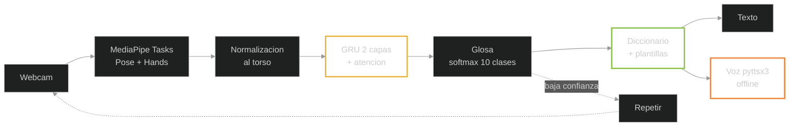

# SignVoice — Reconocimiento de señas y conversión a voz

### Traductor asistido por visión por computadora y aprendizaje supervisado para la Lengua de Señas Mexicana

**Entrega 1 — Introducción, Objetivos, Marco teórico y Marco referencial; la sección V (Ingeniería)
se inicializa aquí y se completa en la 2.ª entrega.**

---

## Portada

> **Universidad / Departamento:** ______ · **Asignatura:** Práctica de IA · **Grupo:** 11 ·
> **Profesor(a):** ______ · **Fecha:** 10 / 11 / 2026 · **Ciudad, Estado:** ______
>
> **Integrantes** (matrícula: ______):
> 1. Camacho Cabrera Vladimir — integración y modelado
> 2. León Flores Luis Santiago — datos y captura
> 3. Mangudo Betancur Carlos Junior — modelado y experimentos
> 4. Paz Colque Willy Samuel — post‑proceso lingüístico
> 5. Romero Cruz Juan Ignacio — TTS, interfaz y demo
> 6. Tellez Angulo Jose Manuel — ética y validación externa
> 7. Totora Huanca Franz Gabriel — documentación y calidad

**Índice:** I. Introducción · II. Objetivos · III. Marco teórico · IV. Marco referencial ·
V. Ingeniería (inicializada) · VI. Referencias

---

# I. Introducción

## 1.1 Planteamiento del problema

La OMS estima **430 millones de personas** (5 % de la humanidad) con necesidad de rehabilitación
audiológica (OMS, 2024); la ONU, **≈ 70 millones de personas sordas** y **más de 300 lenguas de
señas**, ninguna universal (Naciones Unidas, 2021), y la Convención sobre los Derechos de las
Personas con Discapacidad exige accesibilidad lingüística (Naciones Unidas, 2006). En México la LSM
es lengua nacional reconocida en 2005 (CONADIS, 2019), con **estructura lingüística propia** (Cámara
de Diputados, 2011); sin embargo, la **escasez de intérpretes** limita salud, justicia y educación
(ITESO, 2024).

El problema es de **asimetría lingüística**: la mayoría habla español y no conoce la LSM. Un
traductor **señas → texto → voz** comunicaría sin intérprete en contextos de bajo riesgo: del video
se extraen los puntos corporales del señante (*landmarks*), se reconoce la **glosa** (transcripción
escrita de la seña), y se emite como frase de español en voz sintética. Es difícil porque las señas
son **dinámicas**, hay **coarticulación** entre señas y la LSM tiene **gramática propia**: traducir
palabra a palabra no basta.

## 1.2 Justificación

**Social:** la Convención sobre los Derechos de las Personas con Discapacidad exige garantizar la
comunicación (Naciones Unidas, 2006). **Técnica:** la ruta de esqueleto rinde comparable a la de
píxeles con modelos mucho más ligeros (§3.1). **Científica:** el estado del arte se concentra en
cuatro lenguas — **120 datasets en 35 lenguas** (Ni et al., 2026)— y la LSM está subrepresentada, con
corpus pequeños y de captura muy controlada (Hilario-Acuapan et al., 2025); como la mayoría de las
cifras nacionales (96‑99 %) entrena y prueba con el mismo señante, **reportar números con señantes no
vistos es en sí un aporte**.

## 1.3 Alcance, supuestos y limitaciones

**Hace:** landmarks con **MediaPipe Tasks Pose (33 puntos) + Hands (21 por mano)** en una webcam;
normalización relativa al torso; **señas aisladas** de **10 glosas** del dataset público Espejel CES
2024 (Espejel et al., 2024); **GRU con atención temporal**; glosa→español con **diccionario y
plantillas**; texto y **voz offline**. Se asume señante de frente, a 1,5‑3 m, torso y manos visibles,
buena iluminación, un clip = una seña.

**No hace (deliberadamente):** conversación libre; gramática completa de LSM; reconocimiento
**continuo** con CTC; dactilología como módulo principal; **sustituir a un intérprete certificado**:
es asistencia de bajo riesgo, nunca canal único en decisiones médicas o legales.

**Limitaciones declaradas:** Espejel son **imágenes JPEG** (~15 frames/palabra), no video: la señal
temporal es corta; fondo y ropa **negros** a 2,5 m, que pueden degradar la detección del torso; un
solo sitio (estudiantes sordos de 11‑21 años); no se modelan **señales no manuales** (cara, cabeza);
dominio cerrado de 10 glosas. Se reportará la caída entre condiciones, no una sola cifra.

## 1.4 Preguntas de investigación e hipótesis

**RQ1.** ¿Un GRU de dos capas con atención temporal sobre landmarks normalizados **generaliza a
señantes no vistos** (top‑1 ≥ 85 %) en 10 glosas aisladas? **RQ2.** ¿Un post‑proceso **determinista**
(diccionario + plantillas) produce español inteligible para una persona firmante en ≥ 90 % de 50
casos? **RQ3.** ¿El sistema completo opera **sin internet** en un portátil común con latencia ≤ 2 s?

**Hipótesis:** con **validación cruzada por señante (leave‑one‑signer‑out, LOSO)** se alcanzará
top‑1 ≥ 85 % en señante no visto, sin cámara de profundidad ni sensores. Es una meta **moderada**:
una GRU de dos capas con 3 000 secuencias de 30 signos llegó a **97,11 %** (Mejía-Pérez et al.,
2022) y 121 glosas dinámicas, a **F1 = 94 %** con evaluación independiente del señante
(Navarrete-López et al., 2026).

---

# II. Objetivos

## 2.1 Objetivo general

Desarrollar un prototipo que, desde una cámara web, reconozca **señas aisladas de LSM** de 10
glosas, las traduzca a una frase de español y la emita en **voz sintética offline**, entrenado con
un **dataset público etiquetado** y evaluado con validación **independiente del señante**.

## 2.2 Objetivos específicos

| # | Objetivo | Verificación |
|---|---|---|
| OE1 | Elegir las **10 glosas** mejor surtidas de Espejel, con traducción de persona firmante externa. | `glossary/LSM.yaml` validado |
| OE2 | Curar y submuestrear el dataset; divisiones **LOSO** por señante. | *Splits* + ficha del dataset |
| OE3 | Extraer y normalizar al torso los landmarks (Pose + Hands). | *Spike* con ~20 imágenes |
| OE4 | Entrenar el GRU con atención y semilla fija. | F1 macro ± desviación, 3 corridas por fold |
| OE5 | Post‑proceso glosa→español con diccionario y plantillas. | ≥ 90 % de 50 frases inteligibles |
| OE6 | Demo con webcam, texto y voz **offline**. | Latencia ≤ 2 s; ≥ 10 FPS en CPU |
| OE7 | Evaluar y reportar de forma honesta. | Top‑1 y F1 por fold; matriz de confusión |

## 2.3 Criterios de éxito medibles

| Métrica | Mínima | Deseada |
|---|---|---|
| Top‑1 en **señante no visto** | 75 % | **≥ 85 %** |
| **F1 macro** | 0,70 | ≥ 0,85 |
| Inteligibilidad (50 casos, persona firmante) | 80 % | ≥ 90 % |
| Latencia fin de seña → voz | ≤ 2,0 s | ≤ 1,0 s |
| FPS de landmarks en CPU | ≥ 10 | ≥ 20 |
| Caída de F1 macro entre folds | ≤ 15 pts | ≤ 10 pts |

**Criterio de selección, fijado antes de experimentar:** gana la configuración con mejor **F1 macro
promediada en los folds LOSO**; empate de hasta un punto, menor latencia; el test ciego se abre **una
sola vez**.

## 2.4 Descripción general del sistema

---
# III. Marco teórico

## 3.1 Aprendizaje supervisado y de píxeles a landmarks

El **aprendizaje supervisado** aprende una función entrada→salida desde **ejemplos etiquetados**:
aquí, la trayectoria de landmarks de un clip y la glosa que le asignaron sus autores. Dos conceptos
condicionan el proyecto: el **sobreajuste**, que en señas es traicionero —el modelo aprende a
reconocer **a la persona**, no **la seña**—, y la **generalización** a señantes no vistos.

Tres representaciones hay para la entrada: **píxeles** (todo el detalle; costosos, sensibles al
fondo), **landmarks** (coordenadas articulares: ligeras, invariantes al fondo, tiempo real en CPU) y
**sensores** (inalcanzables). La evidencia decide: en **WLASL** (2 000 signos, >100 señantes) la
pose rinde comparable a la apariencia (Li et al., 2020). **MediaPipe Tasks** da 21 landmarks 3D por
mano y 33 puntos corporales (Google Research, 2026); la *z* es relativa y menos confiable, de ahí
normalizar y filtrar por visibilidad.

## 3.2 La LSM como lengua

La LSM **no es español gestual**: tiene fonología, morfología, sintaxis y léxico propios
(Cámara de Diputados, 2011; Hilario-Acuapan et al., 2025). Sus parámetros: configuración de mano,
ubicación, movimiento, orientación de la palma y **señales no manuales** (cara, cejas, cabeza), que
son **gramática**: marcan pregunta, negación e intensidad. Cambiar un parámetro cambia la palabra:
**el modelo necesita manos y cuerpo** —añadir el codo al modelo recupera puntos (Hilario-Acuapan
et al., 2025)— y un clasificador de imágenes fijas es estructuralmente insuficiente. El léxico tiene
dos capas: **dactilología** (alfabeto manual, estático) e **ideologías** (signos dinámicos):
trabajamos ideologías. La LSM varía por región y edad, y no coincide con la lengua de signos
española ni con la argentina.

## 3.3 Niveles del campo: SLR, SLT y glosas

El campo distingue **SLR** (video → secuencia de **glosas**) y **SLT** (señas → frase gramatical)
(Ni et al., 2026). La **glosa** (`YO`, `AYUDA`, `MAÑANA`) es la transcripción escrita de la seña: la
única anotación escalable. La dificultad depende de dos ejes: seña **estática** vs **dinámica**, y
**aislada** (un clip = una seña) vs **continua** (señas seguidas, coarticuladas). El continuo es la
frontera del campo, inalcanzable este semestre: empezamos, como el antecedente nacional más cercano,
por **señas aisladas dinámicas** (Navarrete-López et al., 2026).

## 3.4 Modelos de secuencia: por qué GRU con atención temporal

Una seña es una **serie de tiempo multivariable**. Un **GRU** es recurrencia con memoria (variante
barata de LSTM), adecuada para cientos o miles de secuencias: con 3 000, una GRU de dos capas llegó a
97,11 % (Mejía-Pérez et al., 2022). La **atención temporal** pondera los frames informativos y hace
explicable el modelo: el clip `T × F × 3` pasa por la GRU, la atención genera pesos por frame y un
softmax clasifica entre las 10 glosas. Descartamos por sobredimensionados **ST‑GCN**, **Transformer**
(se sobreentrena sin preentrenamiento) y **CTC** (su ventaja es la señal continua, fuera de alcance).

## 3.5 Evaluación creíble: separación por señante y métricas

Si los clips de un mismo señante están en entrenamiento y prueba, el modelo reconoce **a la
persona** (complexión, ropa, fondo), no la seña: es **fuga de datos**. Los trabajos nacionales
reportan 96‑99 % con particiones aleatorias; al exigir generalización las cifras bajan: **MSLR**
(29 clases, **102 señantes**) llega a **92 %** (Rodriguez et al., 2025); 121 glosas, **F1 = 94 %**
con evaluación independiente del señante (Navarrete-López et al., 2026); WLASL (2 000 glosas),
**62,63 % top‑10** (Li et al., 2020): **toda cifra se reporta con el número de clases**. De ahí
nuestras reglas: división **por señante y sesión**, **LOSO** con test ciego una sola vez, **top‑1 y
F1 macro** (penaliza lucirse solo en clases frecuentes), matriz de confusión, media ± desviación de
3 semillas y **criterio pre‑registrado** (§2.3).

## 3.6 Síntesis de voz offline

La demo **no puede depender de internet**: **pyttsx3** (síntesis del sistema operativo, MIT, sin red)
tras una única interfaz `speak(texto)` que permite cambiar de motor sin tocar el resto. Piper (voz
neuronal local es_MX, GPL‑3.0) es la alternativa de calidad; edge‑tts y gTTS dependen de la nube.

## 3.7 Datos, privacidad y ética

Se trabaja con un **dataset público** (CC BY, caras desdibujadas, consentimiento declarado; Espejel
et al., 2024), en vez de grabar datos biométricos de terceros sin marco institucional; el estándar
lo marcan los precedentes con comité de bioética y consentimiento escrito (Hilario-Acuapan
et al., 2025). Principios: **nada sobre nosotros sin nosotros** (vocabulario e inteligibilidad los
valida una persona sorda firmante), **minimización** (se publica código, glosario y landmarks, no
rostros), **transparencia de límites** (se publican las métricas reales) y **no sustituir
intérpretes**.

---

# IV. Marco referencial

## 4.1 Panorama y antecedentes nacionales en LSM

El estado del arte se concentra en cuatro lenguas: la revisión de **120 datasets en 35 lenguas** lo
documenta (Ni et al., 2026). En LSM hay diez años de línea continua: 2022, cámara de profundidad +
**GRU de dos capas, 97,11 %** con 3 000 secuencias (Mejía-Pérez et al., 2022). 2024, dataset abierto
de **249 palabras / 31 442 imágenes** de estudiantes sordos (Espejel et al., 2024). 2025, **MSLR** (29 clases, 102
señantes, 92 % con SVM; Rodriguez et al., 2025) y Cinvestav (74 signos): escalar de 5 a 62 clases
baja la exactitud de 0,9599 a 0,6375 (Hilario-Acuapan et al., 2025). 2026, antecedente más cercano a
nuestro pipeline: 121 glosas con **MediaPipe**, **F1 = 94 %**, evaluación independiente del señante
(Navarrete-López et al., 2026).

## 4.2 Datasets disponibles y su brecha

| Dataset | Clases | Datos | Señantes | Acceso |
|---|---|---|---|---|
| **Espejel (2024)** —base— | 249 palabras | 31 442 imágenes, fondo negro | ~11, **sordos** (11‑21 años) | **CC BY 4.0** |
| MSLR (Rodriguez, 2025) —plan B— | 29 | 2 411 videos, fondo blanco | **102** | Público |
| Hilario‑Acuapan (2025) | 74 | 1 257 videos | 17 | No publicado |
| Navarrete‑López (2026) | 121 glosas | Video, pantalla verde | 10 | Solicitar a autores |

**Brecha:** ningún corpus LSM combina vocabulario grande, muchos señantes **sordos** y condiciones
realistas, y la evaluación con **señante no visto** es la excepción: con ella las cifras bajan de las
96‑99 % habituales a 92 % (MSLR) y F1 = 94 % (Navarrete‑López). Este proyecto se mide con esa vara:
**10 glosas, señante no visto (LOSO), top‑1 objetivo ≥ 85 %**.

## 4.3 Vacío identificado y posicionamiento

Cuatro huecos abordables por un equipo estudiantil: (1) **evaluación por señante no visto como
norma**, reportando la caída entre condiciones; (2) **MediaPipe Tasks en webcam sin pantalla verde**,
la condición real del usuario; (3) **voz en español de México, offline y con latencia medida**;
(4) **post‑proceso glosa→español publicado y validado** por persona firmante. **Posicionamiento:** no
el mejor modelo del mundo, sino **un sistema completo, honesto y reproducible**: en un campo con
cifras infladas por fuga de datos, **la honestidad metodológica es la contribución**.

---

# V. Ingeniería (inicializada)

Se completa en la **2.ª entrega** con los experimentos y sus métricas.

**Stack:** Python 3.11 · PyTorch (CPU en el desarrollo; CUDA con versiones fijadas para el
entrenamiento final) · MediaPipe Tasks con `.task` locales · GRU + atención · diccionario y
plantillas · pyttsx3 · Gradio · `typer` · YAML · `ruff` + `pytest`. Reglas: ≤ 8 módulos en `src/`,
**≤ 100 líneas por archivo**, funciones puras para normalización, *splits* y post‑proceso, **el
idioma como dato** y **código en inglés; español solo en lo que el usuario ve y oye**.

**Contrato de datos:** clip de N frames → 33 (pose) + 42 (manos) puntos con visibilidad → tensor
normalizado por torso `T × F × 3` → glosa → frase → voz, sin descargas en ejecución; protocolo de
evaluación: el **pre‑registrado en §2.3 y §3.5**.

| Fase | Semanas | Entregable |
|---|---|---|
| 0 · Andamiaje e informe 1 | 1 | Este informe; *walking skeleton* `cámara → landmarks → glosa simulada → frase → voz` |
| 1‑2 · Datos y modelo | 2‑6 | Espejel curado; *spike* de MediaPipe; *splits* LOSO; GRU + atención entrenado |
| 3 · Frase y offline | 7‑8 | Glosa→español validado; demo sin internet → **2.ª entrega** |
| 4 · Cuentas y roles | 9‑10 | API local con login sobre el mismo núcleo; **primera fase recortable** |
| 5 · Cierre | 11‑16 | Demo final e informe final → **3.ª entrega** |

---

# VI. Referencias

Formato APA 7.ª edición.

Cámara de Diputados del H. Congreso de la Unión. (2011, con reformas). *Ley General para la
Inclusión de las Personas con Discapacidad*. https://www.diputados.gob.mx/LeyesBiblio/pdf/LGIPD.pdf

CONADIS. (2019). *Día nacional de la Lengua de Señas Mexicana (LSM)*.
https://www.gob.mx/conadis/articulos/dia-nacional-de-la-lengua-de-senas-mexicana-lsm-203888

Espejel, J., Jalili, L. D., Cervantes, J., & Cervantes Canales, J. (2024). Sign language images
dataset from Mexican sign language. *Data in Brief, 55*, 110566.
https://doi.org/10.1016/j.dib.2024.110566

Google Research. (2026). *MediaPipe: Pose Landmarker y Hand Landmarker* (documentación oficial).
https://developers.google.com/edge/mediapipe/solutions/vision/pose_landmarker

Hilario-Acuapan, G., Ordaz-Hernández, K., Castelán, M., & Lopez-Juarez, I. (2025). Toward a
recognition system for Mexican sign language: Arm movement detection. *Sensors, 25*(12), 3636.
https://doi.org/10.3390/s25123636

ITESO. (2024). *Las manos que faltan en la inclusión: la escasez de intérpretes de LSM*.
https://iteso.mx/web/general/detalle?group_id=22026402

Li, D., Rodriguez, C., Yu, X., & Li, H. (2020). Word-level deep sign language recognition from
video: A new large-scale dataset and methods comparison. En *Proceedings of the IEEE/CVF Winter
Conference on Applications of Computer Vision* (pp. 1459–1469). IEEE.
https://doi.org/10.1109/WACV45572.2020.9090991

Mejía-Pérez, K., Córdova-Esparza, D. M., Terven, J., Herrera-Navarro, A. M., García-Ramírez, V., &
Ramírez-Pedraza, A. (2022). Automatic recognition of Mexican sign language using a depth camera and
recurrent neural networks. *Applied Sciences, 12*(11), 5523. https://doi.org/10.3390/app12115523

Naciones Unidas. (2006). *Convención sobre los Derechos de las Personas con Discapacidad*.
https://www.un.org/esa/socdev/enable/documents/tccconvs.pdf

Naciones Unidas. (2021). *Día Internacional de las Lenguas de Señas (23 de septiembre)*.
https://www.un.org/es/observances/sign-languages-day

Navarrete-López, J. A., Sainos-Vizuett, M., & Lopez-Nava, I. H. (2026). Automatic recognition of
dynamic signs of Mexican sign language using deep learning. *Frontiers in Artificial
Intelligence, 9*, 1794923. https://doi.org/10.3389/frai.2026.1794923

Ni, Y., Cheng, Z.-Q., Li, J., & Cheng, W. (2026). Sign-language datasets at scale: A comprehensive
survey on resources, benchmarks, and annotation standards. En *Proceedings of the 64th Annual
Meeting of the Association for Computational Linguistics*. https://arxiv.org/abs/2606.19352

Organización Mundial de la Salud. (2024). *Sordera y pérdida de la audición* (nota descriptiva).
https://www.who.int/es/news-room/fact-sheets/detail/deafness-and-hearing-loss

Rodriguez, M., Oubram, O., Bassam, A., Lakouari, N., & Tariq, R. (2025). Mexican sign language
recognition: Dataset creation and performance evaluation using MediaPipe and machine learning
techniques. *Electronics, 14*(7), 1423. https://doi.org/10.3390/electronics14071423
