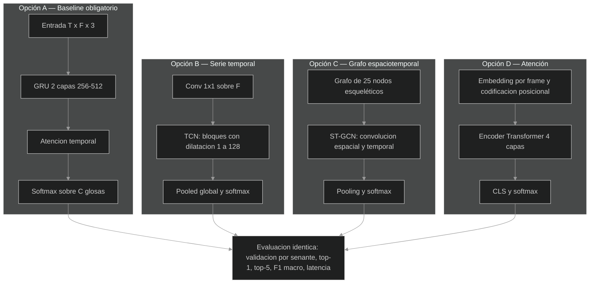
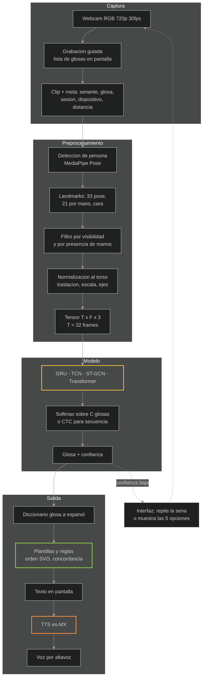
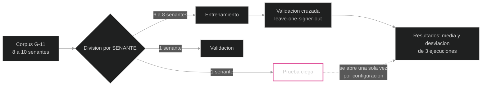
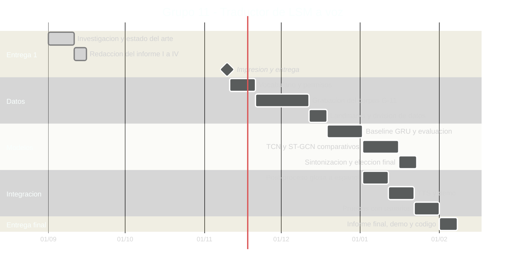

# Reconocimiento de señas y conversión a voz

### Traductor asistido por visión por computadora y aprendizaje supervisado para la Lengua de Señas Mexicana

**Entrega 1 — Introducción, Objetivos, Marco teórico y Marco referencial**

---

## Portada (llenar datos)

> **Universidad / Departamento**
>
> **Asignatura:** Práctica de Inteligencia Artificial
>
> **Título del proyecto:** Reconocimiento de señas y conversión a voz: traductor asistido por
> visión por computadora y aprendizaje supervisado para la Lengua de Señas Mexicana
>
> **Grupo / Equipo:** Grupo 11
>
> **Integrantes:**
> 1. Camacho Cabrera Vladimir — matrícula: ______ — rol: integración y modelado
> 2. León Flores Luis Santiago — matrícula: ______ — rol: datos y captura
> 3. Mangudo Betancur Carlos Junior — matrícula: ______ — rol: modelado y experimentos
> 4. Paz Colque Willy Samuel — matrícula: ______ — rol: post-proceso lingüístico
> 5. Romero Cruz Juan Ignacio — matrícula: ______ — rol: TTS, interfaz y demo
> 6. Tellez Angulo Jose Manuel — matrícula: ______ — rol: consentimiento y ética
> 7. Totora Huanca Franz Gabriel — matrícula: ______ — rol: documentación y calidad
>
> **Profesor(a) / Director(a) de práctica:** ______________________
>
> **Fecha de entrega:** 10 / 11 / 2026
>
> **Ciudad, Estado:** ______________________

> **Pendiente antes de imprimir (borrar esta nota):** completar matrículas, nombre del profesor(a) y
> ciudad; confirmar que el rol asignado a cada integrante coincide con lo que hizo, y borrar la
> sección final "Notas de edición".

---

## Índice

1. **Introducción**
   1.1 Planteamiento del problema
   1.2 Justificación
   1.3 Alcance, supuestos y limitaciones
   1.4 Preguntas de investigación
   1.5 Hipótesis
   1.6 Metodología general y estructura del documento
2. **Objetivos**
   2.1 Objetivo general
   2.2 Objetivos específicos
   2.3 Criterios de éxito medibles
   2.4 Descripción general del sistema
3. **Marco teórico**
   3.1 Inteligencia artificial y aprendizaje supervisado
   3.2 Visión por computadora: de píxeles a landmarks
   3.3 La Lengua de Señas Mexicana como lengua: parámetros y gramática
   3.4 Reconocimiento y traducción de lenguas de señas: niveles, glosas y paradigmas
   3.5 Modelos de secuencia: RNN/GRU/LSTM, TCN, ST-GCN y Transformer
   3.6 Reconocimiento continuo, coarticulación y CTC
   3.7 Del reconocimiento al habla: síntesis de voz (TTS) en español
   3.8 Evaluación creíble: separación por señante, fuga de datos y métricas
   3.9 Datos, privacidad y ética en la captura de señas
4. **Marco referencial**
   4.1 Panorama internacional
   4.2 Antecedentes nacionales en LSM
   4.3 Datasets disponibles y su brecha
   4.4 Proyectos y productos previos
   4.5 Tabla comparativa de antecedentes
   4.6 Vacío identificado y posicionamiento del proyecto
5. **Referencias**
6. **Anexos** — A: arquitectura propuesta · B: cronograma · C: roles y entregables ·
   D: vocabulario preliminar de glosas · E: modelo de consentimiento informado

---

# I. Introducción

## 1.1 Planteamiento del problema

La comunicación entre personas sordas y personas oyentes sigue siendo una barrera cotidiana en
México. La Organización Mundial de la Salud estima que **430 millones de personas** en el mundo
(5 % de la población, de las cuales 34 millones son niños) requieren rehabilitación auditiva, y
proyecta que para 2050 más de **700 millones** la necesiten (OMS, 2024). Las Naciones Unidas
cifran en **≈ 70 millones** las personas sordas y recuerdan que existen **más de 300 lenguas de
señas** distintas, **sin que exista una lengua de señas universal** (Naciones Unidas, 2021). En
México, el Censo de Población y Vivienda 2020 registró **6 179 890 personas con discapacidad**,
es decir 4,9 % de la población (INEGI, 2020), y los estudios del sector reportan **más de cuatro
millones de personas con barreras auditivas** (Navarrete-López et al., 2026).

La Lengua de Señas Mexicana (LSM) fue reconocida como lengua nacional el **10 de junio de 2005**
(CONADIS, 2019) y la Ley General para la Inclusión de las Personas con Discapacidad la reconoce
como lengua con **estructura lingüística propia** y como **patrimonio lingüístico de las personas
sordas de México** (Cámara de Diputados, 2011). Pese a ese reconocimiento formal, la
infraestructura de comunicación es escasa: la **falta de intérpretes de LSM** limita el acceso a
salud, justicia, educación y servicios públicos (ITESO, 2024; CDHCM, 2020).

El problema, por tanto, es de **asimetría lingüística**: la gran mayoría de la población habla y
escucha español, y no conoce la LSM. Un traductor automático de **señas → texto → voz** permitiría
que una persona sorda se comunique con una persona oyente **sin depender de la disponibilidad de
un intérprete** en contextos de bajo riesgo: información general, primer contacto en un mostrador,
trámites sencillos, apoyo didáctico.

Técnicamente, el problema se formula como una tarea de **aprendizaje supervisado con visión por
computadora**: dado un video capturado por una cámara, el sistema debe (a) localizar las manos, el
cuerpo y la cara del señante, (b) reconocer la secuencia de **glosas** que componen la seña, (c)
convertir esa secuencia en una frase de español y (d) reproducirla en voz alta mediante síntesis
de voz. Es una tarea de alta complejidad por tres razones concretas: las señas son **dinámicas**
(la información está en el movimiento, no en una pose fija), hay **coarticulación** (el final de
una seña se fusiona con el inicio de la siguiente) y la LSM tiene **gramática propia**, por lo que
la traducción palabra a palabra no es suficiente.

## 1.2 Justificación

**Social.** Ampliar la accesibilidad comunica con hechos: los artículos 9, 21, 24 y 30 de la
Convención sobre los Derechos de las Personas con Discapacidad obligan a garantizar el acceso a la
información y la comunicación, con reconocimiento expreso de las lenguas de señas (ONU, 2006).

**Técnica.** Los avances de la última década hacen viable lo que antes exigía laboratorio:
**MediaPipe** entrega landmarks de pose, manos y cara en tiempo real sobre una webcam común
(Google Research, 2026) y en el campo se demostró que **la representación por esqueleto rinde de
manera comparable a la representación por píxeles** en el benchmark de referencia WLASL, con
modelos mucho más ligeros (Li et al., 2020).

**Científica, y es la más importante para este grupo.** El estado del arte está concentrado en
cuatro lenguas (ASL, BSL, CSL y DGS) y en datasets con miles de horas de video; en una revisión
sistemática reciente se documentan **120 datasets en 35 lenguas de señas** (Ni et al., 2026). La
LSM está históricamente **subrepresentada**: los corpus nacionales publicados son pequeños
(entre 29 y 249 clases; 8 a 31 señantes) y con condiciones de captura muy controladas
(Hilario-Acuapan et al., 2025). **El vacío no es de ideas, es de datos y de condiciones
controladas.** Un equipo estudiantil que construye un corpus pequeño, bien anotado, con
señantes validados y una evaluación **independiente del señante** produce evidencia útil y
replicable; la mayoría de los trabajos previos evalúan con el mismo señante en entrenamiento y
prueba, y eso infla sus cifras.

**Metodológica.** Es un proyecto donde el aprendizaje supervisado se aplica de principio a fin:
etiquetado, ingeniería de rasgos, división de datos sin fuga, entrenamiento, métricas y análisis
de errores. Cada decisión tiene una consecuencia medible, que es exactamente lo que se evalúa en
una práctica de inteligencia artificial.

## 1.3 Alcance, supuestos y limitaciones

**El sistema hace:** detección de persona y landmarks con MediaPipe Holistic sobre video de
cámara RGB; normalización geométrica de landmarks; clasificación de **glosas aisladas** de un
vocabulario cerrado de **40 a 60 signos dinámicos de LSM**; post-proceso de la secuencia de glosas
a una frase de español con plantillas y reglas; salida de texto en pantalla y salida de voz con
síntesis de voz en español.

**El sistema NO hace (fuera de alcance, declarado deliberadamente):**

| Fuera de alcance | Motivo |
|---|---|
| Conversación libre, vocabulario abierto | Requiere corpus de miles de horas de LSM anotada |
| Gramática completa de LSM (verbos direccionales, asentamiento espacial de referentes) | Exige anotación lingüística especializada y datos que no existen |
| Señales no manuales en la versión inicial | Se contempla como experimento de ablation; se declara como limitación |
| Reconocimiento de dactilología (alfabeto manual) como módulo principal | Priorizamos ideologías (señas dinámicas); la dactilología queda como módulo anexo |
| Avatar, producción de señas (SLP), aplicación móvil nativa, integración con salud o justicia | No son el objetivo de la práctica |
| Sustituir a un intérprete certificado | La herramienta es **asistencia** en contextos de bajo riesgo, nunca canal único en decisiones médicas o legales |

**Supuestos.** (1) El señante está dentro del encuadre, de frente a la cámara, a 1,5–3 m, con el
torso y ambas manos visibles. (2) Iluminación razonable y fondo poco recargado. (3) Cada clip
contiene una secuencia corta de una a cinco glosas. (4) Existe acceso a al menos una persona
firmante o intérprete profesional para validar el vocabulario.

**Limitaciones declaradas.** Corpus pequeño y de un solo sitio; variación dialectal y por edad no
cubierta; sesgo de señante; calidad lingüística del módulo de traducción dependiente de reglas;
dominio cerrado (el vocabulario de urgencias, salud, campus, etc., no generaliza a conversación
libre). Reportaremos la caída de exactitud entre condiciones en lugar de una sola cifra.

## 1.4 Preguntas de investigación

1. **RQ1.** ¿Qué representación de entrada —solo manos, manos+cuerpo, manos+cuerpo+cara—
   generaliza mejor a **señantes no vistos** en LSM con un corpus pequeño?
2. **RQ2.** ¿Qué arquitectura secuencial (GRU, TCN, ST-GCN, Transformer) ofrece el mejor equilibrio
   entre exactitud y latencia para un vocabulario cerrado de 40–60 glosas dinámicas?
3. **RQ3.** ¿Cómo convertir una secuencia de glosas con sintaxis de LSM en español inteligible con
   recursos limitados: reglas y plantillas, o modelo estadístico entrenado con corpus paralelo de
   texto (Lara-Ortiz et al., 2025)?
4. **RQ4.** ¿Qué nivel de exactitud y qué tipo de errores son aceptables para personas sordas e
   intérpretes en el uso real de un sistema así?

## 1.5 Hipótesis

Un modelo secuencial ligero (GRU o TCN) entrenado sobre **landmarks normalizados de cuerpo y
manos**, con **validación cruzada por señante**, alcanzará al menos **85 % de exactitud top-1** en
un vocabulario de 40–60 glosas dinámicas de LSM, y superará en al menos 10 puntos a un
clasificador de frames individuales, **sin necesidad de cámara de profundidad ni de sensores
corporales**, con una latencia menor a un segundo en hardware de consumo.

La evidencia que sustenta la hipótesis: con solo 3 000 secuencias de 30 signos, una red GRU de dos
capas sobre landmarks 3D alcanzó **97,11 %** (Mejía-Pérez et al., 2022); con 121 glosas dinámicas
de LSM capturadas con cámara y MediaPipe Holistic se reportó **F1 = 94 %** con validación
independiente del señante (Navarrete-López et al., 2026).

## 1.6 Metodología general y estructura del documento

Metodología en cinco fases, con entregable evaluable en cada una:

1. **Diseño del corpus:** definición del vocabulario con apoyo de persona firmante/intérprete,
   protocolo de captura, consentimiento informado.
2. **Captura y preprocesamiento:** grabación, extracción de landmarks, normalización, división
   de datos **por señante** y documento tipo *datasheet* (Ni et al., 2026).
3. **Modelado supervisado:** línea base (GRU) y tres alternativas (TCN, ST-GCN, Transformer) con
   protocolo de evaluación idéntico y pruebas de ablation.
4. **Post-proceso y voz:** diccionario glosa→español, plantillas de frase y síntesis de voz en
   español de México.
5. **Integración, evaluación y documentación:** demo, métricas, matriz de confusión, análisis de
   errores y latencia.

Este documento contiene la **primera entrega**: Introducción (sección I), Objetivos (sección II),
Marco teórico (sección III) y Marco referencial (sección IV), seguido de las referencias en APA 7
y los anexos con la arquitectura, el cronograma, el reparto de roles, el vocabulario preliminar y
el modelo de consentimiento.

---

# II. Objetivos

## 2.1 Objetivo general

Desarrollar un prototipo de sistema de asistencia comunicativa que, mediante **visión por
computadora** y un **modelo de aprendizaje supervisado** entrenado con datos propios, reconozca
señas de la **Lengua de Señas Mexicana** capturadas con una cámara, las traduzca a una frase de
español y la emita en **voz sintética**, evaluando su desempeño con una metodología de validación
independiente del señante.

## 2.2 Objetivos específicos

| # | Objetivo específico | Verificación |
|---|---|---|
| **OE1** | **Definir y validar un vocabulario cerrado de 40 a 60 glosas de LSM**, con categorías semánticas y su traducción al español, revisadas con una persona sorda firmante o intérprete profesional. | Glosario `glossary.yaml` con validación firmada por el experto |
| **OE2** | **Construir un corpus propio de video de LSM** con al menos 8 señantes (idealmente 2–3 personas sordas usuarias de LSM), con consentimiento informado y cumplimiento de la LFPDPPP. | ≥ 4 000 clips con metadatos de señante, sesión y dispositivo + consentimiento 100 % |
| **OE3** | **Implementar la extracción y normalización de rasgos** con MediaPipe Holistic (pose, manos y cara) y normalización geométrica relativa al torso, y comparar tres conjuntos de rasgos: manos, manos+cuerpo, manos+cuerpo+cara. | Tabla de ablation de tres filas, misma semilla y división |
| **OE4** | **Entrenar y comparar cuatro arquitecturas secuenciales** —GRU, TCN, ST-GCN y Transformer— bajo un protocolo idéntico, con **división de datos por señante** (validación cruzada *leave-one-signer-out*). | Cuatro curvas de entrenamiento, media ± desviación de 3 ejecuciones |
| **OE5** | **Diseñar el post-proceso glosa → español** con diccionario, plantillas de frase y reglas de orden y concordancia, y validarlo con una persona experta en LSM. | Frases inteligibles en ≥ 90 % de 50 casos de prueba |
| **OE6** | **Integrar la salida de voz** con un motor de síntesis de voz en español y una interfaz con cámara, midiendo latencia y tasa de frames. | Latencia fin de seña → inicio de voz ≤ 1,0 s; ≥ 15 FPS en CPU |
| **OE7** | **Evaluar y reportar de forma honesta** el desempeño (top-1, top-5, F1 macro, matriz de confusión, análisis de los errores por par lingüístico) y las limitaciones del sistema. | Informe final con métricas por fold y análisis de errores |
| **OE8** | **Documentar y liberar** el código, el dataset anonimizado (landmarks), el protocolo de captura y el datasheet, para que el proyecto sea reproducible y el corpus reutilizable. | Repositorio público, dataset publicado con licencia abierta |

> Criterio de calidad de los objetivos: cada uno tiene un **número o un artefacto verificable**.
> Un objetivo que no se pueda comprobar con una tabla, un archivo o una métrica no es un objetivo.

## 2.3 Criterios de éxito medibles

| Nivel | Métrica | Meta mínima | Meta deseada |
|---|---|---|---|
| Clasificación de glosa aislada | **Top-1** en señante no visto | 75 % | **≥ 85 %** |
| Clasificación de glosa aislada | **F1 macro** (equilibrio entre clases) | 0,70 | ≥ 0,85 |
| Secuencia corta (2–5 glosas) | **WER** sobre la secuencia de glosas | ≤ 40 % | ≤ 30 % |
| Traducción a español | Juicio humano de inteligibilidad | 80 % | ≥ 90 % |
| Sistema completo | **Latencia** (fin de seña → inicio de voz) | ≤ 2,0 s | ≤ 1,0 s |
| Sistema completo | **FPS** de extracción de landmarks en CPU | ≥ 10 | ≥ 20 |
| Robustez | Caída de exactitud entre condiciones (señante, distancia, iluminación) | ≤ 15 puntos | ≤ 10 puntos |
| Ética y datos | Consentimientos firmados y anonimización de caras en lo publicado | **100 %** | 100 % |

**Criterio de selección del modelo (fijado antes de experimentar, para no elegir el resultado a
conveniencia):** gana el modelo con mejor **F1 macro en el promedio de los folds de validación por
señante**; en empate de hasta un punto, gana el de **menor latencia**.

## 2.4 Descripción general del sistema (objetivo traducido a arquitectura)

```mermaid
%%{init: {'theme':'dark','themeVariables':{'darkMode':true,'primaryTextColor':'#e6e6e6','nodeTextColor':'#e6e6e6','edgeLabelColor':'#e6e6e6','lineColor':'#9a9a9a'},'themeCSS':'.nodeLabel,.nodeText,.edgeLabel,.label{color:#e6e6e6!important}'}}%%
flowchart LR
    A[Camera: webcam 720p 30fps] --> B[Deteccion de persona<br/>pose de 33 puntos]
    B --> C[Extraccion de landmarks<br/>21 por mano, cara y torso]
    C --> D[Normalizacion<br/>traslacion, escala, ejes relativos al torso]
    D --> E[Segmentacion de la sena<br/>ventana deslizante]
    E --> F[Modelo secuencial<br/>GRU - TCN - ST-GCN - Transformer]
    F --> G[Clasificacion de glosas<br/>softmax o CTC + confianza]
    G --> H[Post-proceso linguistico<br/>glosas a espanol]
    H --> I[Texto en pantalla]
    H --> J[Sintesis de voz TTS es-MX]
    J --> K[Altavoz o auricular]
    G -.->|baja confianza| L[Pedir repeticion en la interfaz]
    L -.-> A
    style F fill:none,stroke:#e8b339,stroke-width:2.5px
    style H fill:none,stroke:#8bc34a,stroke-width:2.5px
    style J fill:none,stroke:#f0863c,stroke-width:2.5px
```

Cada objetivo específico corresponde a un bloque: OE1 y OE2 a la captura; OE3 a los bloques C y D;
OE4 a los bloques E, F y G; OE5 al bloque H; OE6 a los bloques I, J y K; OE7 y OE8 a la evaluación
y la documentación transversal.

---

# III. Marco teórico

## 3.1 Inteligencia artificial y aprendizaje supervisado

La inteligencia artificial construye sistemas que toman decisiones útiles a partir de datos. El
**aprendizaje supervisado** es la familia de métodos en la que el modelo aprende una función
de entrada a salida a partir de **ejemplos etiquetados**: en este proyecto, la entrada es la
trayectoria de landmarks de una secuencia de video y la salida es la **glosa** correspondiente,
asignada por un humano. El proceso estándar es: definir la tarea y el vocabulario → reunir y
etiquetar datos → dividir los datos en entrenamiento, validación y prueba → extraer rasgos →
entrenar minimizando una función de pérdida → medir con métricas adecuadas → analizar errores.

Dos conceptos que condicionan todo el proyecto:

- **Sobreentrenamiento (sobreajuste):** el modelo memoriza los ejemplos en vez de aprender el
  patrón. En reconocimiento de señas se manifiesta de forma traijera: el modelo aprende a
  reconocer **a la persona**, no **la seña** (véase §3.8).
- **Generalización:** lo que importa es el desempeño en datos **no vistos**, en particular en
  señantes no vistos. Es el criterio que separa un resultado creíble de uno inflado.

Los **modelos profundos** (redes neuronales con varias capas apiladas) son el estándar del campo
porque aprenden la representación de forma automática y porque existen bibliotecas maduras
(PyTorch; Paszke et al., 2019). La **clasificación** es la tarea base: asignar una etiqueta
discreta a una entrada; la **secuencia** de clases, y la **traducción automática** de secuencias,
son extensiones de la misma idea con mecanismos de alineación temporal (§3.6).

## 3.2 Visión por computadora: de píxeles a landmarks

La visión por computadora extrae información de imágenes y video (OpenCV; Bradski, 2000). Para
reconocer señas hay tres caminos con implicaciones muy distintas en costo y precisión:

| Paradigma de representación | Qué usa el modelo | Ventaja | Desventaja |
|---|---|---|---|
| **Píxeles (appearance)** | Frames recortados, o secuencias de frames, alimentando una red convolucional o 3D-CNN | Conserva toda la información (dedos, textura, ropa) | Costoso, sensible al fondo y a la iluminación, exige muchos datos y GPU |
| **Esqueleto / landmarks (pose)** | Coordenadas de articulaciones: cuerpo, manos, cara | Ligero, invariante al fondo, tiempo real en CPU, estable entre señantes | Pierde detalle de textura y de los puntos sin detectar |
| **Sensores (guantes, trajes, IMU)** | Señales de sensores en dedos y muñecas | Muy preciso, sin problemas de iluminación | Hardware caro, incómodo, no usable en la vida real |

La evidencia empírica decide el camino. En **WLASL**, el benchmark público de referencia con
2 000 signos y más de 100 señantes, los modelos de apariencia (I3D) y de pose (Pose-TGCN) rinden
de manera comparable en top-5 y top-10, con la diferencia de que la ruta de pose opera sobre
esqueletos (Li et al., 2020). Esto justifica usar landmarks: un modelo más pequeño, entrenable en
un día, evaluable con transparencia.

**MediaPipe** (Google Research, 2026) es la herramienta que hace esto práctico sobre una webcam:
**Hands** entrega **21 landmarks 3D por mano**, **Pose** **33 puntos** del cuerpo y **Holistic**
integra **543** puntos (33 de pose + 21 × 2 manos + 468 de cara), con una opción de
complejidad de modelo (0, 1, 2) que permite intercambiar precisión por velocidad. La coordenada *z*
es relativa y menos confiable que *x* e *y*, de ahí la normalización y el filtrado por
visibilidad. La alternativa con cámara de profundidad (Kinect, OAK-D) entrega 3D real y se usó en
los antecedentes nacionales (García-Bautista et al., 2017; Mejía-Pérez et al., 2022); la elegimos
en la comparativa, no como requisito, porque el proyecto debe funcionar con la cámara del
portátil.

## 3.3 La Lengua de Señas Mexicana como lengua: parámetros y gramática

La LSM **no es español gestual**: es una lengua con fonología, morfología, sintaxis y léxico
propios (Cámara de Diputados, 2011; Hilario-Acuapan et al., 2025). Conocer su estructura no es un
adorno del marco teórico: **determina qué datos hay que capturar y qué rasgos tiene el modelo**.

**Parámetros de la seña** —la equivalente a la "fonología" de una lengua oral—:

1. **Configuración de mano** (*handshape*): forma de la mano y de los dedos.
2. **Ubicación** (*location*): punto del cuerpo o del espacio donde se articula.
3. **Movimiento** (*movement*): trayectoria, dirección y velocidad.
4. **Orientación de la palma**: hacia dónde mira la palma.
5. **Señales no manuales**: expresión facial, cejas, cabeza y mirada. No son "expresividad":
   son **gramática** (marcan pregunta, negación, intensidad, aspecto).

Cambiar un parámetro cambia la palabra: dos señas pueden compartir configuración de mano y
distinguirse **solo** por la ubicación. Consecuencia técnica directa y verificable: **el modelo
necesita manos, cuerpo y cara**; un clasificador de imágenes de la mano es estructuralmente
insuficiente.

Hilario-Acuapan et al. (2025) proponen para LSM una taxonomía de tres componentes que usaremos
como diseño de rasgos:

| Componente | Sigla | Fuente de datos en MediaPipe |
|---|---|---|
| **Configuración de mano** (*hand configuration*) | HC | 21 landmarks por mano |
| **Movimiento de brazo** (*arm movement*) | AM | Hombro, codo, muñeca (33 de pose) |
| **Gesto no manual** (*non-manual gesture*) | NHG | Cara (468), hombros y cuello |

Además, el léxico de LSM tiene dos capas que conviene separar:

- **Dactilología** (alfabeto manual): deletreo de nombres propios y extranjerismos; mayormente
  estático y con buena representación en datasets nacionales (Martínez-Seis et al., 2019).
- **Ideologías** (signos léxicos con movimiento y contacto corporal): el grueso del vocabulario y
  la parte **dinámica**, que es la que exige modelos de secuencia. Nuestro vocabulario prioriza
  ideologías; la dactilología queda como módulo anexo.

Finalmente, hay **variación dialectal y sociolingüística**: la LSM varía por región y por edad, y
no coincide con la lengua de signos española ni con la lengua de señas argentina. Esto explica por
qué un modelo entrenado con datos extranjeros no sirve tal cual en México, y por qué la validación
con hablantes locales es parte del diseño y no un extra.

## 3.4 Reconocimiento y traducción de señas: niveles, glosas y paradigmas

El campo se organiza en tres tareas que se suelen confundir (Rastgoo et al., 2021; Vinson et al.,
2021):

- **SLR** (*sign language recognition*): del video a la **secuencia de glosas**.
- **SLT** (*sign language translation*): de las señas a una **frase gramatical** de una lengua
  hablada (aquí, español).
- **SLP** (*sign language production*): la inversa, de texto a una animación que firma. **Fuera de
  alcance de este proyecto.**

La **glosa** es la pieza clave: es la transcripción escrita de una seña, normalmente en MAYÚSCULAS
(`YO`, `AYUDA`, `MAÑANA`), y es el puente entre el video y el español. Toda la literatura trabaja
con glosas porque es la única anotación escalable: no se puede anotar la sintaxis profunda de
miles de videos con recursos de un semestre.

Dos distinciones que definen la dificultad:

| Eje | Opción A | Opción B |
|---|---|---|
| **Temporalidad de la seña** | **Estática**: una pose basta (p. ej. el alfabeto manual) | **Dinámica**: hace falta la secuencia de frames (la mayoría de las señas de LSM) |
| **Segmentación del video** | **Aislada**: un clip = una seña | **Continua**: muchas señas seguidas, sin cortes, con coarticulación |

El reconocimiento **continuo de señales de señas** (CSLR/CSLT) es la frontera del campo: los
sistemas más avanzados (transformadores de señas; Camgöz et al., 2020; SignFormer-GCN; Arib et
al., 2025; Sign2GPT; Wong et al., 2024) operan ahí, y los reportes de calidad de traducción son
todavía bajos (BLEU-4 ≈ 0,58 en una lengua de bajos recursos). Un proyecto estudiantil debe
empezar por **señas aisladas dinámicas** y escalar: es la ruta que permitió a Navarrete-López et
al. (2026) llegar a F1 = 94 % en LSM.

Tres paradigmas de representación, que ordenan la historia del campo:

1. **Rasgos artesanales** (DTW, plantillas, segmentación por color, Haar/HOG): explicables y con
   pocos datos; dependen de un preprocesamiento frágil (García-Bautista et al., 2017; Espejel et
   al., 2021).
2. **Rasgos intermedios (landmarks)**: pose, manos y cara estimados por red y consumidos por un
   modelo de secuencia. **Es la ruta de este proyecto**, con precedente nacional exitoso
   (Navarrete-López et al., 2026).
3. **Aprendizaje de representación extremo a extremo**: CNN/3D-CNN o transformadores sobre píxeles
   o embeddings; máximo rendimiento, máximo costo en datos y cómputo (Li et al., 2020; Camgöz et
   al., 2020).

## 3.5 Modelos de secuencia: RNN/GRU/LSTM, TCN, ST-GCN y Transformer

Una seña es una **serie de tiempo multivariable**: en cada frame hay un vector de coordenadas. Por
eso el corazón del sistema es un modelo de secuencia, no un clasificador de imágenes.

| Modelo | Idea en una línea | Cuándo conviene |
|---|---|---|
| **LSTM / GRU** | Recurrencia con memoria: procesa frames en orden y mantiene un estado. GRU es la variante más barata de LSTM | Pocos datos (cientos a miles de secuencias); CPU; el baseline que hay que vencer. Con 3 000 secuencias una GRU de dos capas llegó a 97,11 % en LSM (Mejía-Pérez et al., 2022) |
| **TCN** | Convoluciones causales y dilatadas sobre la secuencia: campo receptivo largo y entrenamiento en paralelo | Entrena 3–5 veces más rápido; buen rendimiento con datos limitados |
| **ST-GCN / Pose-TGCN** | Convolución sobre el **grafo del esqueleto** (vecinos anatómicos) y en el tiempo | Datos de pose; señas bimanuales y frases, porque modela la relación mano↔hombro (Yan et al., 2018; de Amorim & Zanchettin, 2019; Li et al., 2020) |
| **Transformer** | Atención auto-suficiente entre todos los frames | Muchos datos o preentrenamiento (SignBERT; Li et al., 2022); con pocos datos se sobreentrena |

La evidencia del campo sugiere que, en datos limitados, la **tasa de aprendizaje, el agrupamiento
temporal y la regularización** importan más que la profundidad de la red (Navarrete-López et al.,
2026). Por eso el grupo comparará cuatro familias con el mismo protocolo en vez de perseguir la
arquitectura más exótica.

## 3.6 Reconocimiento continuo, coarticulación y CTC

En el habla y en las señas, **la frontera entre unidades no está marcada en la señal**: el final de
una seña se funde con el inicio de la siguiente (**coarticulación**), y no hay cortes naturales
entre señas en una frase fluida. Por eso no basta con entrenar un clasificador de clips: el campo
resuelve la alineación temporal con **CTC** (*Connectionist Temporal Classification*; Graves et
al., 2006), una función de pérdida que entrena la red para emitir una secuencia de etiquetas a
partir de una secuencia de frames **sin necesitar saber en qué frame empieza y termina cada seña**.
CTC es hoy la base del reconocimiento continuo de señas (Vinson et al., 2021).

Plan del proyecto en dos niveles, para no prometer lo que los datos no permiten:

- **Fase 1 (entrega actual):** glosas **aisladas** con softmax y ventana deslizante; secuencias
  cortas de 1 a 5 glosas capturadas como unidades separadas.
- **Fase 2 (si el tiempo y los datos alcanzan):** secuencia continua con CTC sobre el mismo
  esqueleto del modelo.

## 3.7 Del reconocimiento al habla: síntesis de voz en español

La última etapa es **TTS** (*text-to-speech*): convertir la frase de español en audio. Las
opciones se diferencian por calidad, licencia y necesidad de internet:

| Motor | Tipo | Español de México | Licencia | Internet | Uso previsto |
|---|---|---|---|---|---|
| **pyttsx3** | Sintesis del sistema operativo | A dependencia del sistema | MIT | No | **Predeterminado** (demo sin red) |
| **Piper** | Neuronal local (ONNX/VITS) | Sí (`es_MX-claude`) | GPL-3.0 | No | **Recomendado** si se acepta GPL |
| **edge-tts** | Voces neuronales en la nube | Sí (`es-MX`) | MIT | Sí | Demo de alta calidad con red |
| **gTTS** | Nube | Sí | MIT | Sí | Respaldo |
| **Coqui XTTS-v2** | Neuronal, clonación de voz | Sí | CPML (restringe uso comercial) | No | No se usa por licencia |

Criterio de elección: **la demo no puede depender del internet** en el aula. Se implementa una
interfaz única `speak(texto, motor)` para poder cambiar de motor sin tocar el resto del sistema, y
audio pregrabado de respaldo para la presentación.

## 3.8 Evaluación creíble: separación por señante, fuga de datos y métricas

Este es el punto donde más investigaciones se autoengañan. Si los clips de un mismo señante
aparecen en entrenamiento y en prueba, el modelo reconoce **a la persona** (complexión, ropa,
fondo, cámara) y no la seña: es una **fuga de datos**. El efecto es enorme: los trabajos de LSM
reportan cifras de **96,44 % a 99,75 %** con particiones aleatorias, mientras que al exigir
generalización a señantes no vistos los números reales caen; en el dataset **MSLR** (29 clases,
2 411 videos, **102 señantes**) el mejor clasificador llega a **92 %** (Rodriguez et al., 2025) y
en el corpus nacional de 121 glosas se reporta **F1 = 94 %** con evaluación independiente del
señante (Navarrete-López et al., 2026). En ASL, en datos comunitarios reales, el top-1 bajó a
**58,03 %** (ASL Citizen, NeurIPS 2023 Datasets and Benchmarks). Y en el escenario de 2 000 glosas
de WLASL, el mejor top-10 fue de **62,63 %** (Li et al., 2020): la exactitud depende del tamaño
del vocabulario, y por eso **toda cifra debe reportarse junto con el número de clases**.

Reglas de evaluación que adopta este grupo:

1. **División por señante** (y por sesión/dispositivo), nunca aleatoria a nivel de clip.
2. **Validación cruzada *leave-one-signer-out***: cada fold deja fuera a un señante completo; el
   conjunto de prueba se abre **una sola vez** por configuración.
3. **Métricas:** top-1, top-5, **F1 macro** (penaliza lucirse solo en las clases frecuentes),
   matriz de confusión, WER para secuencias, BLEU/chrF/TER para la traducción, latencia y FPS.
4. **Estadística básica:** media ± desviación de 3 ejecuciones con semilla fija; el conjunto de
   validación se usa para el ajuste de hiperparámetros y se reporta la prueba por separado.
5. **Análisis de errores por par lingüístico:** ¿el modelo confunde señas que comparten
   configuración de mano? ¿falla en las señas bimanuales? ¿en las de movimiento rápido?

## 3.9 Datos, privacidad y ética en la captura de señas

Un corpus de señas es **data biométrica en sentido amplio**: video de rostros, cuerpos y manos de
personas identificables, con un componente sensible por tratarse de salud y discapacidad. El
marco mexicano exige aviso de privacidad, consentimiento y finalidades definidas (LFPDPPP). Los
precedentes académicos marcan el estándar: el dataset del Instituto CES **desdibuja las caras** y
declara su base jurídica (Espejel et al., 2024), y Cinvestav aprobó su corpus con **comité de
bioética (protocolo 105/2023)** y consentimiento informado escrito de sus 17 participantes
(Hilario-Acuapan et al., 2025).

Principios que adopta el proyecto:

1. **"Nada sobre nosotros sin nosotros"**: el vocabulario, la validez de las glosas y la
   inteligibilidad de las frases se validan con personas sordas firmantes o intérpretes
   profesionales, no por intuición del grupo.
2. **Consentimiento informado revocable**, explicado en LSM (con interpretación) y por escrito,
   con lenguaje claro.
3. **Minimización:** publicamos landmarks (coordenadas), no rostros ni voces.
4. **Transparencia de límites:** publicamos las métricas reales, incluida la caída de desempeño
   con señantes nuevos. Un sistema que falla y lo dice es seguro; uno que calla, no.
5. **No sustituir intérpretes:** la herramienta es asistencia en contextos de bajo riesgo, no un
   canal único en decisiones médicas o legales.
6. **Beneficio comunitario:** el glosario y el corpus anonimizado se devuelven a la comunidad.

Documentamos el dataset con la ficha estandarizada del campo, el *Sign-Language Datasheet* de 24
campos derivado de la revisión de 120 datasets (Ni et al., 2026): origen, señantes, condiciones de
captura, licencias, sesgos y usos previstos y prohibidos.

---

# IV. Marco referencial

## 4.1 Panorama internacional

El estado del arte se concentra en unas pocas lenguas y en datasets grandes. La revisión de **120
datasets en 35 lenguas de señas** presentada en ACL 2026 documenta la concentración en ASL, BSL,
CSL y DGS, el desequilibrio entre modalidades y el sesgo de señante, y estandariza la
documentación de corpus (Ni et al., 2026). Los benchmarks que fijan las expectativas:

| Dataset | Lengua | Escala | Hallazgo para nosotros |
|---|---|---|---|
| **WLASL** (Li et al., 2020) | ASL | 2 000 signos, > 100 señantes, 10 h | Mejor **top-10 = 62,63 %**; appearance y pose comparables |
| **PHOENIX-14T** (Camgöz et al., 2020) | DGS | 7 096 / 519 / 642 segmentos | Estándar de traducción continua con CTC y transformadores |
| **How2Sign** (Duarte et al., 2021) | ASL | 80 h, multimodal | Plantilla de anotación de señas continuas |
| **ASL Citizen** (NeurIPS 2023 D&B) | ASL | 87 h comunitarias | **58,03 %** top-1: el costo de la calidad y variedad de datos reales |

Productos comerciales que demuestran viabilidad y a la vez sus límites: **SignAll** (reconocimiento
continuo en la nube), **Hand Talk** (App y avatar, Brasil), **MotionSavvy** (videotelefonía) y
**Signly** (Google, diccionario de AUSLAN). Ninguno resuelve la conversación libre en LSM, y todos
restringen su uso a contextos de bajo riesgo.

## 4.2 Antecedentes nacionales en LSM

México tiene una línea de investigación continua de diez años, con una evolución clara: de sensores
y segmentación artesanal, a cámaras de profundidad, y desde 2022 a landmarks y redes de secuencia.

- **2016–2017 — pre-deep-learning.** Reconocimiento desde frames de video (Cervantes et al., 2016)
  y LSM con **Kinect + DTW** (García-Bautista et al., 2017): ruta explicable, dependiente de
  hardware de profundidad y de una segmentación frágil.
- **2019 — dactilología móvil.** Alfabeto LSM estático y dinámico en smartphone con aprendizaje
  profundo (Martínez-Seis et al., 2019) y software de adquisición de datos (Martínez-Gutiérrez et
  al., 2019): el antecedente directo de nuestra app de captura.
- **2021 — el límite de la segmentación por color.** Segmentación de LSM por red neuronal de color
  de piel (Espejel et al., 2021): muestra que la segmentación de fondo es el cuello de botella de
  la ruta de píxeles, y motiva la ruta de landmarks.
- **2022 — el referente metodológico.** Reconocimiento de LSM con **cámara de profundidad y RNN**:
  30 signos (4 estáticos, 26 dinámicos), **3 000 secuencias**, rasgos 3D normalizados al torso
  (5 puntos de cuerpo, 20 de cara, 21 por mano), **GRU de dos capas con 97,11 %** y ~90 % con ruido
  alto (Mejía-Pérez et al., 2022). Demuestra que **modelos pequeños y datos pequeños funcionan** si
  la representación es la correcta.
- **2022 — señas a voz en salud.** Prototipo de reconocimiento y **síntesis** de LSM de apoyo a
  médico de primer contacto (Sosa-Jiménez et al., 2022): **antecedente directo de nuestro objetivo
  de salida por voz**.
- **2023 — léxico en video.** Inventario de gestos dinámicos frecuentes de LSM (Martínez-Sánchez
  et al., 2023), insumo para la definición del vocabulario.
- **2024 — datos abiertos y traducción bidireccional.** Dataset LSM de **249 palabras / 31 442
  imágenes** de 11 estudiantes sordos, con consentimiento, base jurídica y caras desdibujadas
  (Espejel et al., 2024); y sistema de traducción **bidireccional LSM ↔ español** con aprendizaje
  profundo (González-Rodríguez et al., 2024).
- **2025 — datasets y evaluación rigurosa.** **MSLR**: 29 clases (20 estáticas, 9 dinámicas),
  **2 411 videos**, **102 señantes**, tres sesiones en tres días, con **92 %** con SVM
  (Rodriguez et al., 2025). **Cinvestav**: 74 signos, **1 257 videos** de 17 señantes con comité de
  bioética; clasificador YOLOv8 sobre rasgos de brazo y mano, con el hallazgo de que al escalar de
  5 a 62 clases la exactitud cae de 0,9599 a 0,6375, y que **añadir el codo** (movimiento de brazo)
  recupera puntos (0,6375 → 0,6537; top-5 0,8640 → 0,8932) (Hilario-Acuapan et al., 2025). Corpus
  paralelo **español ↔ glosa LSM** de ~18 000 pares para tareas de lenguaje (Lara-Ortiz et al.,
  2025). Salud: 150 señas con aumento sintético y RNN (Becerril-Carrillo et al., 2025).
- **2026 — el antecedente más cercano a nuestro pipeline.** Reconocimiento de **121 glosas
  dinámicas de urgencias médicas** con cámara (Nikon D5500, 1080p/60 fps, pantalla verde),
  **MediaPipe Holistic**, aumento por muestreo de frames, 10 señantes guiados por videos de
  intérpretes expertos, **F1 = 94 %** con evaluación independiente del señante
  (Navarrete-López et al., 2026).

## 4.3 Datasets disponibles y su brecha

| Dataset | Clases | Videos / imágenes | Señantes | Captura | Licencia / acceso |
|---|---|---|---|---|---|
| Espejel et al. (2024) | 249 palabras, 17 áreas | 31 442 imágenes | ~11 por palabra, **sordos** (CES, 11–21 años) | Cámara 12,1 MP a 2,5 m, fondo y ropa negros | CC BY 4.0 (Mendeley Data) |
| MSLR — Rodriguez et al. (2025) | 29 (20 estát. + 9 dinám.) | 2 411 | **102** | 4 iPhones, fondo blanco, 3 sesiones | Público (verificar términos) |
| Hilario-Acuapan et al. (2025) | 74 signos | 1 257 (900×720, 90 fps) | 17 | Cámara de estudio, bioética 105/2023 | No publicado íntegro |
| Mejía-Pérez et al. (2022) | 30 signos | 3 000 secuencias | 4 | OAK-D (profundidad) | Solicitar a autores |
| Navarrete-López et al. (2026) | 121 glosas de urgencias | Secuencias de video | 10 (no expertos) | Nikon D5500 1080p/60 fps, pantalla verde | Solicitar a autores |
| Lara-Ortiz et al. (2025) | Corpus de **texto** | ~18 000 pares español ↔ glosa | n/a | Texto | Abierto |
| Zenodo 14689869 | Alfabeto LSM dinámico | Secuencias | — | Cámara | Abierto |
| Mozilla Data Collective | Corpus LSM (Querétaro) | Audio/voz LSM | — | Micrófono/cámara | Abierto con licencia |

**Brecha:** (a) ningún corpus LSM combina vocabulario grande, muchos señantes **sordos** y
condiciones de captura realistas; (b) los que tienen muchos señantes tienen pocas clases; (c) casi
todos son de estudio con fondo controlado; (d) la evaluación por señante no visto es la excepción,
no la regla. **Esto es exactamente el espacio que ocupa un corpus propio, pequeño y bien
evaluado.**

## 4.4 Proyectos y productos previos (herramientas de referencia)

| Proyecto | Qué hace | Qué tomamos de él |
|---|---|---|
| `dxli94/WLASL` + `ZechengLi19/Awesome-Sign-Language` | Benchmark, código y lista curada del campo | Protocolo de evaluación top-K; mapa de literatura |
| `lxtGH/st-gcn` | ST-GCN sobre esqueletos (acción y señas) | Implementación de la opción C del modelo |
| `amorim-cleison/st-gcn-sl` | ST-GCN aplicado a reconocimiento de señas | Adaptación al grafo de MediaPipe |
| `ryanwongsa/Sign2GPT` (ICLR 2024) | Glosas → español/inglés con LLM | Plantilla del post-proceso de la fase 2 |
| `jpablo-ortiz/Reconocimiento-LSC` | Antecedente latinoamericano (Lengua de Señas Colombiana) | Referencia regional de pipeline con MediaPipe |
| MediaPipe, PyTorch, PyTorch Geometric, CTC scikit-learn, OpenCV, Gradio | Stack | Herramientas del prototipo (Apache-2.0, BSD-3) |

## 4.5 Tabla comparativa de antecedentes

| Estudio | País | Enfoque | Vocabulario | Datos | Modelo | Métrica | ¿Señante no visto? |
|---|---|---|---|---|---|---|---|
| Cervantes et al. (2016) | México | Frames de video | Pequeño | Video | Clasificadores clásicos | Media | No declarado |
| García-Bautista et al. (2017) | México | RGB-D + DTW | Pequeño | Kinect | DTW | Alta en dominio | No |
| Martínez-Seis et al. (2019) | México | Alfabeto LSM en móvil | 27 letras | Imágenes | CNN | Alta en dominio | No |
| Espejel et al. (2021) | México | Segmentación por color | Media | Video | Red de color | IoU / exactitud | n/a |
| Mejía-Pérez et al. (2022) | México | Profundidad + RNN | 30 signos | 3 000 sec. | **GRU 512-256** | **97,11 %** | Parcial (ruido) |
| Sosa-Jiménez et al. (2022) | México | Señas → voz en salud | Médico | Video + TTS | Clasificador + TTS | Aceptación | No declarado |
| Espejel et al. (2024) | México | **Dataset** de 249 palabras | 249 | 31 442 img. | n/a | n/a | n/a |
| González-Rodríguez et al. (2024) | México | Traducción bidireccional | Media | Video + texto | Red secuencia-secuencia | Exactitud de traducción | Parcial |
| Rodriguez et al. (2025) | México | **Dataset** MSLR + SVM | 29 | 2 411 | **SVM** | **92 %** | **Sí** (102 señantes) |
| Hilario-Acuapan et al. (2025) | México | Movimiento de brazo | 74 | 1 257 | **YOLOv8-cls** | 0,6375–0,9599 | Parcial |
| Lara-Ortiz et al. (2025) | México | **Corpus paralelo** texto | ~18 000 pares | Texto | n/a | n/a | n/a |
| Becerril-Carrillo et al. (2025) | México | Salud, datos sintéticos | 150 | ~800 sec./palabra | RNN | Alta en dominio | No |
| **Navarrete-López et al. (2026)** | México | **Cámara + MediaPipe** | **121** | Video | Red de secuencia | **F1 = 94 %** | **Sí** |
| Li et al. (2020) | Internacional | Appearance vs pose | **2 000** | 10 h | I3D / Pose-TGCN | **62,63 % top-10** | **Sí** |
| Camgöz et al. (2020) | Internacional | Reconstrucción + traducción | 7 096 segmentos | PHOENIX-14T | Transformer | BLEU | Sí |
| Arib et al. (2025) | Internacional | Traducción continua, bajos recursos | Media | BornilDB | Transformer + GCN | BLEU-4 0,58 | Sí |
| **Este proyecto** | México | **Cámara RGB + landmarks + TTS** | **40–60 glosas** | ~4 000 clips propios | GRU/TCN/ST-GCN/Transformer | **Objetivo top-1 ≥ 85 %** | **Sí (LOSO)** |

## 4.6 Vacío identificado y posicionamiento del proyecto

Al cruzar los antecedentes se ven cuatro huecos concretos, y todos son abordables por un equipo
estudiantil en un semestre:

1. **Evaluación por señante no visto como norma.** La mayoría de las cifras nacionales (96–99 %)
   provienen de particiones aleatorias. Nosotros reportamos **solo** números con división por
   señante, y reportamos la caída entre condiciones. Es un aporte metodológico, no solo técnico.
2. **Landmarks de LSM con MediaPipe en condiciones no de estudio.** Solo Navarrete-López et al.
   (2026) documentan este pipeline en LSM, con pantalla verde. Nosotros capturamos **sin pantalla
   verde** y con webcam, que es la condición real del usuario.
3. **Salida de voz en español de México con latencia medida.** El antecedente de salud
   (Sosa-Jiménez et al., 2022) no reporta latencia ni FPS; nosotros los medimos y publicamos, porque
   la utilidad del sistema depende de eso.
4. **Post-proceso glosa → español documentado.** Casi ningún trabajo nacional lo describe. Nosotros
   liberamos el diccionario, las plantillas y la validación con experto, y usamos el corpus paralelo
   de Lara-Ortiz et al. (2025) para medirlo.

**Posicionamiento en una frase:** no pretendemos el mejor modelo del mundo; pretendemos **un sistema
completo, honesto y reproducible** —cámara → landmarks → glosa → español → voz— con un corpus LSM
propio, bien documentado, y una evaluación que no se engaña a sí misma. En un campo donde los
números están inflados por fuga de datos, la honestidad metodológica **es** la contribución.

---

# V. Referencias

Formato APA 7.ª edición. Versión extendida, con enlaces y notas de uso, en
`docs/investigacion/referencias.md`; versión BibTeX en `docs/investigacion/referencias.bib`.

Cámara de Diputados del H. Congreso de la Unión. (2011, con reformas). *Ley General para la
Inclusión de las Personas con Discapacidad*. https://www.diputados.gob.mx/LeyesBiblio/pdf/LGIPD.pdf

Camgöz, N. C., Han, J. E., Kosmala, A., Ray, M., Moeller, A., & Bowden, R. (2018). Neural sign
language translation. En *Proceedings of the IEEE Conference on Computer Vision and Pattern
Recognition* (pp. 5932–5941). IEEE. https://doi.org/10.1109/CVPR.2018.00621

Camgöz, N. C., Mai, J., Feldmann, M., Eisner, M., Rasin, A., Zising, C., & Bowden, R. (2020). Sign
language transformers: Joint end-to-end sign language recognition and translation. En
*Proceedings of the IEEE/CVF Conference on Computer Vision and Pattern Recognition*. IEEE.
https://doi.org/10.1109/CVPR42600.2020.01001

Cervantes, J. G., García-Lamont, F., Rodríguez-Mazahua, L., Rendón, A. Y., & Chau, A. L. (2016).
Recognition of Mexican sign language from frames in video sequences. En *Intelligent Computing.
MICAI 2016* (LNCS 10004, pp. 353–362). Springer. https://doi.org/10.1007/978-3-319-42294-7_31

Comisión de Derechos Humanos de la Ciudad de México. (2020). *Necesario garantizar los derechos de
las personas sordas a través del fortalecimiento de la LSM en el sistema educativo*.
https://cdhcm.org.mx/2020/11/necesario-garantizar-los-derechos-de-las-personas-sordas-a-traves-del-fortalecimiento-de-la-lengua-de-senas-mexicana-en-el-sistema-educativo

CONADIS. (2019). *Día nacional de la Lengua de Señas Mexicana (LSM)*.
https://www.gob.mx/conadis/articulos/dia-nacional-de-la-lengua-de-senas-mexicana-lsm-203888

de Amorim, C. C., & Zanchettin, C. (2019). Spatial-temporal graph convolutional networks for sign
language recognition. *arXiv:1901.11164*

Duarte, K., Palaskar, S., Ventura, L., Ghadiyaram, D., DeHaan, K., Metze, F., Torres, J., &
Giro-i-Nieto, X. (2021). How2Sign: A large-scale multimodal dataset for continuous American sign
language. En *Proceedings of the IEEE/CVF Conference on Computer Vision and Pattern Recognition*
(pp. 2735–2744). IEEE. https://doi.org/10.1109/CVPR46443.2021.00276

Espejel, J., Jalili, L. D., Cervantes, J., & Cervantes Canales, J. (2024). Sign language images
dataset from Mexican sign language. *Data in Brief, 55*, 110566.
https://doi.org/10.1016/j.dib.2024.110566

Espejel-Cabrera, J., Cervantes, J., García-Lamont, F., Castilla, J. S. R., & Jalili, L. D. (2021).
Mexican sign language segmentation using color based neuronal networks to detect the individual
skin color. *Expert Systems with Applications, 183*, 115295.
https://doi.org/10.1016/j.eswa.2021.115295

García-Bautista, G., Trujillo-Romero, F., & Caballero-Morales, S. O. (2017). Mexican sign language
recognition using Kinect and data time warping algorithm. En *2017 International Conference on
Electronics, Communications and Computers (CONIELECOMP)* (pp. 1–5). IEEE.
https://doi.org/10.1109/CONIELECOMP.2017.7891832

Google Research. (2026). *MediaPipe: Holistic, Hands and Pose Landmarker* (documentación oficial).
https://developers.google.com/edge/mediapipe/solutions/vision/holistic_landmarker

González-Rodríguez, J. R., Córdova-Esparza, D. M., Terven, J., & Romero-González, J. A. (2024).
Towards a bidirectional Mexican sign language–Spanish translation system: A deep learning
approach. *Technologies, 12*(1), 7. https://doi.org/10.3390/technologies12010007

Graves, A., Fernández, S., Gomez, F., & Schmidhuber, J. (2006). Connectionist temporal
classification: Labelling unsegmented sequence data with recurrent neural networks. En
*Proceedings of the 23rd International Conference on Machine Learning* (pp. 369–376). ACM.
https://doi.org/10.1145/1143844.1143891

Hilario-Acuapan, G., Ordaz-Hernández, K., Castelán, M., & Lopez-Juarez, I. (2025). Toward a
recognition system for Mexican sign language: Arm movement detection. *Sensors, 25*(12), 3636.
https://doi.org/10.3390/s25123636

INEGI. (2020). *La discapacidad en México. Censo de Población y Vivienda 2020*.
https://cuentame.inegi.org.mx/explora/poblacion/discapacidad

ITESO. (2024). *Las manos que faltan en la inclusión: la escasez de intérpretes de LSM*.
https://iteso.mx/web/general/detalle?group_id=22026402

Lara-Ortiz, V., Fuentes-Aguilar, R., & Chairez, I. (2025). Spanish to Mexican Sign Language glosses
corpus for natural language processing tasks. *Scientific Data, 12*(1), 702.
https://doi.org/10.1038/s41597-025-04871-7

Li, D., Rodriguez, C., Yu, X., & Li, H. (2020). Word-level deep sign language recognition from
video: A new large-scale dataset and methods comparison. En *Proceedings of the IEEE/CVF Winter
Conference on Applications of Computer Vision* (pp. 1459–1469). IEEE.
https://doi.org/10.1109/WACV45572.2020.9090991

Martínez-Gutiérrez, M. E., Rojano-Cáceres, J. R., Benítez-Guerrero, E., & Sánchez-Barrera, H. E.
(2019). Data acquisition software for sign language recognition. *Research in Computer Science,
148*, 205–211. https://doi.org/10.13053/rcs-148-3-17

Martínez-Seis, B., Pichardo-Lagunas, O., Rodriguez-Aguilar, E., & Saucedo-Diaz, E.-R. (2019).
Identification of static and dynamic signs of the Mexican sign language alphabet for smartphones
using deep learning and image processing. *Research in Computer Science, 148*, 199–211.
https://doi.org/10.13053/rcs-148-11-16

Martínez-Sánchez, V., Villalón-Turrubiates, I., Cervantes-Álvarez, F., & Hernández-Mejía, C. (2023).
Exploring a novel Mexican sign language lexicon video dataset. *Multimodal Technologies and
Interaction, 7*(8), 83. https://doi.org/10.3390/mti7080083

Mejía-Pérez, K., Córdova-Esparza, D. M., Terven, J., Herrera-Navarro, A. M., García-Ramírez, V., &
Ramírez-Pedraza, A. (2022). Automatic recognition of Mexican sign language using a depth camera and
recurrent neural networks. *Applied Sciences, 12*(11), 5523. https://doi.org/10.3390/app12115523

Naciones Unidas. (2006). *Convención sobre los Derechos de las Personas con Discapacidad*.
https://www.un.org/esa/socdev/enable/documents/tccconvs.pdf

Naciones Unidas. (2021). *Día Internacional de las Lenguas de Señas (23 de septiembre)*.
https://www.un.org/es/observances/sign-languages-day

Navarrete-López, J. A., Sainos-Vizuett, M., & Lopez-Nava, I. H. (2026). Automatic recognition of
dynamic signs of Mexican sign language using deep learning. *Frontiers in Artificial
Intelligence, 9*, 1794923. https://doi.org/10.3389/frai.2026.1794923

Ni, Y., Cheng, Z.-Q., Li, J., & Cheng, W. (2026). Sign-language datasets at scale: A comprehensive
survey on resources, benchmarks, and annotation standards. En *Proceedings of the 64th Annual
Meeting of the Association for Computational Linguistics*. https://arxiv.org/abs/2606.19352

Organización Mundial de la Salud. (2021). *Informe mundial sobre la audición*. OMS/OPS.
https://iris.paho.org/items/8be46ab6-9909-4aae-9b1a-d43316ce12fd

Organización Mundial de la Salud. (2024). *Sordera y pérdida de la audición* (nota descriptiva).
https://www.who.int/es/news-room/fact-sheets/detail/deafness-and-hearing-loss

Paszke, A., Gross, S., Massa, F., Lerer, A., Bradbury, J., Chanan, G., … Chintala, S. (2019).
PyTorch: An imperative style, high-performance deep learning library. En *Advances in Neural
Information Processing Systems 32*. Curran Associates.

Rastgoo, R., Cubukcu, M., Prendinger, H., Kawakami, N., Mita, S., & Wada, T. (2021). Sign language
recognition: A deep survey. *Expert Systems with Applications, 171*, 114594.
https://doi.org/10.1016/j.eswa.2020.114594

Rodriguez, M., [autores por completar], et al. (2025). Mexican sign language recognition: Dataset
creation. *Electronics, 14*(7), 1423. https://doi.org/10.3390/electronics14071423

Sosa-Jiménez, C. O., Ríos-Figueroa, H. V., & Solís-González-Cosío, A. L. (2022). A prototype for
Mexican sign language recognition and synthesis in support of a primary care physician.
*IEEE Access, 10*, 127620–127635. https://doi.org/10.1109/ACCESS.2022.3226696

Vinson, N., Gueuwou, S., & Duran, D. (2021). A technical introduction to sign language recognition
(part 1). *Sign Language Linguistics, 4*(2), 168–191. https://doi.org/10.1075/sll.20052.vin

Wong, R., Albenes, M., Eyzaguirre, F., Tang, S., Hu, X., & Zisserman, A. (2024). Sign2GPT:
Leveraging large language models for gloss-free sign language translation. En *International
Conference on Learning Representations*. https://arxiv.org/abs/2405.04164

Yan, S., Xiong, Y., & Lin, D. (2018). Spatial temporal graph convolutional networks for
skeleton-based action recognition. En *Proceedings of the AAAI Conference on Artificial
Intelligence* (vol. 32). https://doi.org/10.1609/aaai.v32i1.11277

> **Antes de imprimir:** (1) completar la lista de autores de Rodriguez et al. (2025) y de
> Becerril-Carrillo et al. (2025) desde la página oficial del artículo; (2) verificar que cada cifra
> del informe aparezca en una de estas entradas; (3) **no** se cita el dataset "LS-500" porque no
> localizamos su fuente primaria.

---

# Anexos

## Anexo A. Arquitectura propuesta y contrato de datos

Diseño propio del grupo (no copiado de ninguna fuente), derivado de la comparación de paradigmas
de la sección 3.2 y de los antecedentes de la sección 4.2.

**Contrato de datos entre módulos** (para que los integrantes trabajen en paralelo sin pisarse):

| Módulo | Entrada | Salida |
|---|---|---|
| `capture` | cámara / video | `clip.mp4` + `meta {señante, glosa, sesión, dispositivo, distancia}` |
| `landmarks` | `clip.mp4` | `ndarray (T, F, 3)` + lateralidad + visibilidad |
| `normalize` | `(T, F, 3)` | `(T', F', 3)` con T' = 32, coordenadas relativas al torso |
| `dataset` | landmarks + `glossary.yaml` + `splits.json` | `Dataset` y `DataLoader` de PyTorch |
| `model` | lote `(B, 32, F, 3)` | `(B, C)` en tarea aislada; `(B, T', C)` con CTC |
| `postprocess` | secuencia de glosas | frase en español |
| `tts` | frase | audio y reproducción |
| `evaluate` | predicciones y verdad | top-1, top-5, F1 macro, matriz de confusión, WER, latencia, FPS |

## Anexo B. Cronograma de la práctica (16 semanas)

## Anexo C. Roles y entregables (7 integrantes; ajustar al número real)

| Rol | Personas | Entregables verificables |
|---|---|---|
| Integración y lider técnico | 1 | repositorio, `requirements.txt`, fusión de ramas, demo ejecutable |
| Datos y captura | 2 | protocolo, app de captura, corpus G-11, `DATASHEET.md` |
| Modelado y experimentos | 2 | GRU/TCN/ST-GCN, ablation, `results.md`, matriz de confusión |
| Lingüística y post-proceso | 1 | `glossary.yaml`, reglas glosa→español, validación con experto LSM |
| Producto: TTS, interfaz, demo | 1 | interfaz con cámara, medición de latencia y FPS, guía de uso |
| Documentación y calidad | 1 | informes, referencias, diagramas, bitácora semanal de decisiones |

Cada rol es dueño de un **subconjunto de archivos** del repositorio: se evitan conflictos y queda
visible la contribución individual.

## Anexo D. Vocabulario preliminar (52 glosas, sujeta a validación con persona firmante)

Prioridad: **ideologías dinámicas**, una mano y bimanuales, con contraste entre pares que comparten
configuración de mano y difieren en ubicación o movimiento.

| Categoría | Glosas propuestas |
|---|---|
| Saludo y cortesía (7) | HOLA, ADIOS, GRACIAS, POR-FAVOR, PERDON, SI, NO |
| Personas (6) | YO, TÚ, ELLA, NOSOTROS, FAMILIA, AMIGO |
| Tiempo (7) | HOY, MAÑANA, AYER, AHORA, TARDE, NOCHE, SIEMPRE |
| Verbo básico (8) | AYUDAR, IR, VENIR, QUERER, PODER, HABLAR, ENTENDER, ESPERAR |
| Salud y urgencia (10) | DOLOR, CABEZA, ESTOMAGO, MANO, PIE, FIEBRE, MEDICO, EMERGENCIA, AUXILIO, LASTIMADO |
| Lugares y objetos (7) | CASA, ESCUELA, CALLE, HOSPITAL, DINERO, TELEFONO, AGUA |
| Preguntas (5) | QUE, QUIEN, DONDE, CUANDO, POR-QUE |
| Estados (2) | BIEN, MAL |

Cada entrada del glosario se documenta así: `glosa: {categoría, traducciones_al_español,
tipo: estática|dinámica, mano: una|bimanual, parámetros: {configuración, ubicación, movimiento},
plantilla_española, ejemplos, nota_lsm}`. **Ninguna glosa entra al corpus sin la validación de la
persona firmante o intérprete.**

## Anexo E. Consentimiento informado (modelo)

> **Consentimiento informado para participar en la grabación de videos de Lengua de Señas Mexicana**
>
> Proyecto: *Reconocimiento de señas y conversión a voz* — Grupo 11, práctica de Inteligencia
> Artificial.
>
> 1. **Qué se hace:** se graba video de usted realizando señas de LSM con una cámara/webcam, en
>    sesiones de aproximadamente ___ minutos, en ___ (lugar).
> 2. **Para qué sirve:** para entrenar y evaluar un sistema informático que reconoce señas y las
>    convierte en texto y voz con fines académicos.
> 3. **Qué se publica:** el material se usa en la universidad y, en su caso, se publica en acceso
>    abierto. **Se publican coordenadas de las manos, el cuerpo y la cara (landmarks); no se
>    publican videos ni audiciones de su rostro ni de su voz.** En las imágenes que se muestren, los
>    rostros se difuminan.
> 4. **Riesgos y molestias:** sin riesgo médico. Puede haber cansancio por repetir señas.
> 5. **Beneficios:** el glosario y el corpus anonimizado quedan disponibles para la comunidad sorda
>    y para futuros proyectos.
> 6. **Participación voluntaria y revocable:** usted puede negarse, parar en cualquier momento y
>    pedir que se borren sus datos, sin consecuencia alguna.
> 7. **Accesibilidad de este consentimiento:** se le explica en vivo en LSM con interpretación, y
>    puede pedir que se le lea en voz alta.
> 8. **Datos de contacto del equipo:** ___ (nombre, correo, teléfono del responsable del proyecto).
> 9. **Base de protección de datos:** tratamiento conforme a la Ley Federal de Protección de Datos
>    Personales en Posesión de los Particulares; usted puede ejercer sus derechos ARCO en el correo
>    indicado.
>
> Nombre del participante: ______________ Firma: ______________ Fecha: ______________
>
> Persona que explicó el consentimiento en LSM: ______________ Firma: ______________

---

## Notas de edición (borrar antes de imprimir)

1. **Formato de entrega:** portada con los datos reales, índice con números de página, cuerpo en
   Times New Roman 12 e interlineado 1.5, márgenes de 2.5 cm, numeración de páginas, tablas y
   figuras numeradas y referenciadas en el texto, referencias en APA 7 con sangría francesa.
2. **Extensión sugerida:** 18 a 25 páginas de cuerpo (I a IV) + referencias + anexos.
3. **Figuras:** los diagramas Mermaid de este documento y de `docs/investigacion/` se exportan a
   PNG/SVG (mermaid CLI, o la extensión Mermaid de VS Code) y se pegan como imágenes.
4. **Conversión a PDF con pandoc** (una sola vez, desde `docs/informe/`):
   `pandoc entrega1_informe.md -o entrega1_informe.pdf --toc --number-sections -V lang=es`
5. **Defensa oral:** los cinco integrantes que defienden deben poder explicar, sin leer: SLR y SLT,
   glosa, landmark, CTC, *signer-independent* y fuga de datos, top-1 frente a top-5, WER, y las
   cuatro cifras del proyecto (70 M de personas sordas, 430 M con necesidad de rehabilitación,
   6 179 890 personas con discapacidad en México, 94 % de F1 del antecedente más cercano).
   Batería de preguntas con respuesta en `docs/investigacion/06_glosario.md`.
6. **Comprobación final de honestidad:** ninguna cifra del informe queda sin referencia; toda
   promesa de desempeño está marcada como **objetivo**, no como resultado.
