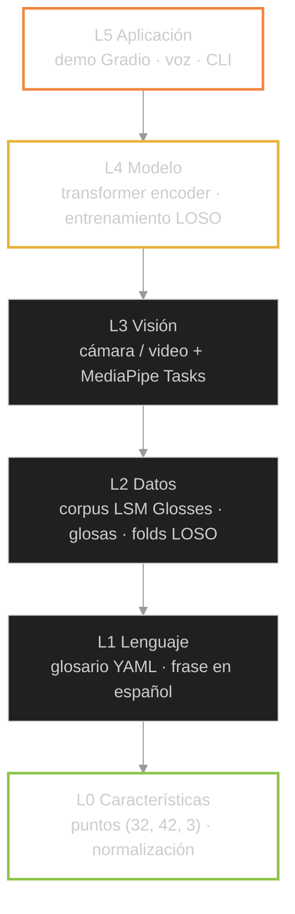

<!-- BORRADOR DE TRABAJO — no imprimir. Base: docx definitivo de la entrega 1
     (Informe-Grupo-11-Aprendizaje-Supervisado-Vision-Artificial.docx, secciones I-IV
     textualmente) + sección V. Ingeniería nueva + referencias.
     Cambios pedidos por la docente (audio 16/11), aplicados 17/11: número de grupo en la
     portada, títulos en minúscula inicial (no todo mayúsculas), ecuaciones numeradas en
     orden de aparición y citadas por número, tablas y figuras numeradas, párrafos de 5-6
     líneas como mínimo y la solución concentrada en la sección V.
     Actualización 17/11 (story 04): fuente de datos LSM Glosses (Zenodo 18330565),
     transformer encoder, resultados LOSO medidos (top-1 0,917 / F1 0,893); parches de
     coherencia en 1.3, OE1/OE3/OE4, 2.4, 3.1, 3.5, 3.7 y tabla 3.
     Revisión de contenido 17/11: deduplicación entre secciones (comparación del paper solo
     en 5.5, antecedentes solo en IV, mecánica del pipeline fuera de 1.3), renumeración de
     tablas 5/6 por orden de aparición, latencia matizada en 5.6 y ecuaciones 1-3 en LaTeX. -->

# SignVoice: reconocimiento de señas y conversión a voz

### Sistema asistido por visión por computadora y aprendizaje supervisado para el reconocimiento de la Lengua de Señas Mexicana

**Entrega 2:** se conserva el informe de la primera entrega y se agrega la sección V
(Ingeniería) con el diseño, los datos y el estado del prototipo.

---

## Portada

> **Universidad Mayor de San Simón**
> **Facultad de Ciencias y Tecnología**
> **Departamento de Informática y Sistemas**
>
> **Asignatura:** Inteligencia Artificial
> **Grupo:** 11
> **Docente:** Ing. Patricia Erika Rodríguez Bilbao
> **Fecha de entrega:** 17 de noviembre de 2026
> **Semestre:** 2/2026
>
> **Integrantes:**
>
> 1. Camacho Cabrera Vladimir, integración y modelado
> 2. León Flores Luis Santiago, datos y captura
> 3. Mangudo Betancur Carlos Junior, modelado y experimentos
> 4. Paz Colque Willy Samuel, post-proceso lingüístico
> 5. Romero Cruz Juan Ignacio, síntesis de voz, interfaz y demo
> 6. Tellez Angulo Jose Manuel, ética y validación externa
> 7. Totora Huanca Franz Gabriel, documentación y calidad

## Índice

I. Introducción. II. Objetivos. III. Marco teórico. IV. Marco referencial. V. Ingeniería.
VI. Referencias.

1. Introducción — 1.1 Planteamiento del problema. 1.2 Justificación. 1.3 Alcance, supuestos
y limitaciones. 1.4 Preguntas de investigación e hipótesis.
2. Objetivos — 2.1 Objetivo general. 2.2 Objetivos específicos. 2.3 Criterios de éxito
medibles. 2.4 Descripción general del sistema.
3. Marco teórico — 3.1 Aprendizaje supervisado y representación de datos. 3.2 Visión por
computadora. 3.3 La LSM como lengua. 3.4 Niveles del campo: reconocimiento, traducción y
glosas. 3.5 Redes neuronales recurrentes GRU. 3.6 Evaluación del reconocimiento. 3.7
Síntesis de voz sin conexión. 3.8 Datos, privacidad y ética.
4. Marco referencial — 4.1 Panorama y antecedentes nacionales en LSM. 4.2 Conjuntos de
datos disponibles y su brecha. 4.3 Vacío identificado y posicionamiento.
5. Ingeniería — 5.1 Arquitectura del sistema. 5.2 Datos: de Espejel a LSM Glosses. 5.3 Spike
de MediaPipe y decisión de representación. 5.4 Extracción desde video y normalización. 5.5
Modelo transformer encoder. 5.6 Entrenamiento LOSO y resultados. 5.7 Estado del prototipo y
trabajo pendiente.
6. Referencias.

Índice de tablas y figuras: Tabla 1, objetivos específicos y su verificación. Tabla 2,
criterios de éxito medibles. Tabla 3, conjuntos de datos de LSM. Tabla 4, ficha del conjunto
Espejel (evidencia del spike). Tabla 5, glosas piloto del corpus LSM Glosses. Tabla 6,
resultados del spike de MediaPipe. Tabla 7, resultados LOSO por pliegue. Figura 1, flujo del
sistema propuesto. Figura 2, referencia de manos obtenidos mediante MediaPipe. Figura 3,
estructura interna de una unidad GRU. Figura 4, arquitectura del sistema en capas.

## Lista de abreviaturas

Instituciones y lengua:

- **OMS:** Organización Mundial de la Salud.
- **ONU:** Organización de las Naciones Unidas.
- **CONADIS:** Consejo Nacional para el Desarrollo y la Inclusión de las Personas con Discapacidad.
- **LSM:** Lengua de Señas Mexicana.

Modelos y tareas:

- **SLR:** reconocimiento de lengua de señas, del inglés *sign language recognition*.
- **SLT:** traducción de lengua de señas, del inglés *sign language translation*.
- **GRU:** unidad recurrente con puerta, del inglés *gated recurrent unit*.
- **LSTM:** red de memoria a largo plazo, del inglés *long short-term memory*.

Evaluación:

- **LOSO:** validación que deja fuera a un señante en cada pliegue, del inglés *leave-one-signer-out*.
- **F1:** media armónica entre precisión y recobro; **F1 macro** es el promedio sin ponderar de la F1 de
  cada clase.

Datos y licencias:

- **CES:** *Computación, Electrónica y Sistemas*, sede académica del conjunto Espejel.
- **MSLR:** *Mexican Sign Language Recognition*, conjunto de datos de LSM de 29 clases.
- **Creative Commons Atribución (CC BY):** licencia que permite usar y compartir la obra citando el
  origen.

Claves internas:

- **OE:** objetivo específico.
- **P:** pregunta de investigación.

---

# I. Introducción

## 1.1 Planteamiento del problema

La Organización Mundial de la Salud (OMS, 2024) estima que 430 millones de personas necesitan rehabilitación auditiva. Por otra parte, la Organización de las Naciones Unidas (ONU, 2021) señala que existen alrededor de 70 millones de personas sordas y más de 300 lenguas de señas en el mundo. En México, la Lengua de Señas Mexicana (LSM) es reconocida como lengua nacional desde 2005 y cuenta con una estructura lingüística propia (CONADIS, 2019; Cámara de Diputados, 2011). Sin embargo, la falta de intérpretes sigue dificultando la comunicación en ámbitos como la salud, la educación y la justicia (ITESO, 2024).

Esta situación representa una barrera de comunicación entre las personas sordas que utilizan la LSM y aquellas que no conocen esta lengua, lo que puede dificultar su participación en distintas actividades de la vida cotidiana. Frente a este problema, se propone desarrollar un sistema capaz de reconocer determinadas señas mediante una cámara, convertirlas en texto y reproducirlas posteriormente mediante una voz sintética.

Para llevar a cabo este proceso, el sistema extraerá del video puntos de referencia del cuerpo y las manos, conocidos como *landmarks*. A partir de estos datos se buscará identificar la seña realizada y obtener su glosa, es decir, su representación escrita. Sin embargo, este reconocimiento presenta ciertos desafíos, ya que las señas combinan movimientos y posiciones que pueden variar entre usuarios. Además, la LSM tiene una gramática propia, por lo que su interpretación no puede reducirse a una traducción palabra por palabra.

## 1.2 Justificación

Social: La Convención sobre los Derechos de las Personas con Discapacidad establece que se debe garantizar la comunicación y reconoce la importancia de las lenguas de señas (Naciones Unidas, 2006). Por ello, SignVoice busca facilitar la comunicación entre las personas sordas que utilizan la LSM y quienes no la conocen.

Técnica: El uso de puntos de referencia del cuerpo y las manos permite reconocer las señas sin tener que procesar directamente todos los píxeles del video. Además, permite trabajar con modelos más ligeros, como se explica en la sección 3.1.

Científica: Las investigaciones sobre reconocimiento de lenguas de señas se han centrado principalmente en cuatro lenguas, mientras que otras, como la LSM, cuentan con menos conjuntos de datos disponibles (Ni et al., 2026). También existen estudios sobre la LSM que utilizan conjuntos de datos pequeños y condiciones de grabación controladas (Hilario-Acuapan et al., 2025). Por esta razón, evaluar el sistema con personas que no participaron en el entrenamiento permitiría conocer mejor su capacidad de reconocer señas en diferentes usuarios.

## 1.3 Alcance, supuestos y limitaciones

El sistema reconocerá diez señas aisladas mediante una cámara web, utilizando el corpus público LSM Glosses (Navarrete-López et al., 2026), que reúne 121 glosas de la Lengua de Señas Mexicana grabadas en video. Para el reconocimiento se extraen del video los puntos de referencia de las manos, se normalizan según las ecuaciones 1 a 3 de la sección 5.4 y la secuencia resultante se clasifica mediante un transformer encoder. Una vez identificada la seña, se convertirá en una frase en español con un glosario y plantillas, y se reproducirá mediante una voz sintética, sin necesidad de conexión a internet.

Se supone que la persona estará de frente a la cámara, a una distancia de entre 1,5 y 3 metros, con las manos y el torso visibles y bajo condiciones de iluminación adecuadas. Además, se realizará una sola seña por cada fragmento analizado.

El proyecto no contempla conversaciones libres, el reconocimiento continuo de señas, la gramática completa de la LSM ni la dactilología como función principal. Tampoco pretende reemplazar a un intérprete certificado, por lo que el sistema no deberá utilizarse como único medio de comunicación en situaciones médicas o legales.

Entre las principales limitaciones se encuentran las siguientes:

- El corpus contiene un solo video por glosa y señante, de modo que el piloto de diez glosas dispone de 120 clips; esta variabilidad limitada explica la diferencia entre pliegues que se reporta en la sección 5.6.
- Los videos fueron grabados frente a una pantalla verde con iluminación controlada; la condición real de una cámara web doméstica puede diferir y se verificará con la prueba de cámara del prototipo.
- Los cuadros en los que una mano no fue detectada se rellenan con el valor del cuadro anterior, lo que introduce información repetida en la secuencia.
- La ventana de 32 cuadros se obtiene por interpolación temporal, ya que los videos originales tienen entre 31 y 58 cuadros grabados a 25-30 cuadros por segundo.
- No se incluyen los movimientos de la cara y la cabeza, que también aportan información importante durante la realización de una seña.
- El reconocimiento estará limitado a las diez glosas seleccionadas para el proyecto, de las 121 disponibles en el corpus.

Finalmente, se evaluará el funcionamiento del sistema en diferentes condiciones y con personas que no hayan participado en el entrenamiento, con el propósito de observar cómo varía su precisión ante distintos usuarios.

## 1.4 Preguntas de investigación e hipótesis

P1. ¿En qué medida un modelo de aprendizaje supervisado basado en redes neuronales profundas puede reconocer diez señas aisladas de la Lengua de Señas Mexicana (LSM), alcanzando al menos un 85 % de precisión al evaluarse con personas que no participaron en el entrenamiento?

P2. ¿El uso de un diccionario y plantillas permite generar expresiones en español que sean comprensibles en al menos 90 % de 50 casos evaluados?

P3. ¿El sistema puede funcionar sin conexión a internet, en un portátil convencional y con un tiempo de respuesta máximo de dos segundos?

**Hipótesis**

Se plantea que el sistema podrá alcanzar al menos un 85 % de precisión al reconocer las diez señas, incluso cuando sea utilizado por personas que no participaron en el entrenamiento. Para comprobarlo, se utilizará una validación que deja fuera a un participante en cada prueba (LOSO). Además, se espera que el sistema funcione sin cámaras especiales ni sensores adicionales, utilizando únicamente una cámara web.

---

# II. Objetivos

## 2.1 Objetivo general

Desarrollar un prototipo que utilice visión por computadora y aprendizaje supervisado para reconocer diez señas aisladas de la Lengua de Señas Mexicana (LSM) mediante una cámara web, convertirlas en texto en español y reproducirlas mediante una voz sintética sin conexión a internet.

## 2.2 Objetivos específicos

Tabla 1. Objetivos específicos y su verificación.

| Clave | Objetivo específico | Verificación |
|---|---|---|
| OE1 | Elegir las diez glosas piloto del corpus LSM Glosses, con traducción validada por persona firmante externa. | Glosario aprobado |
| OE2 | Preparar los datos y realizar divisiones LOSO por señante. | Divisiones y ficha de datos |
| OE3 | Extraer los puntos de las manos desde los videos y normalizarlos por la muñeca. | 120 clips extraídos, 100 % válidos |
| OE4 | Entrenar un transformer encoder con configuración única y semilla fija. | F1 macro por pliegue LOSO |
| OE5 | Convertir la glosa en español con diccionario y plantillas. | 90 % de 50 frases comprensibles |
| OE6 | Implementar el reconocimiento con cámara, texto y voz sin conexión. | Latencia máxima de 2 segundos |
| OE7 | Evaluar y reportar de forma honesta. | Precisión, F1 por pliegue y matriz de confusión |

## 2.3 Criterios de éxito medibles

El criterio de selección del modelo se fija antes de experimentar: gana la mejor F1 macro promediada en los pliegues LOSO; ante un empate de hasta un punto, la menor latencia; y el conjunto ciego se consulta una sola vez.

Tabla 2. Criterios de éxito medibles.

| Métrica | Valor mínimo | Valor deseado |
|---|---|---|
| Acierto en la primera opción, señante no visto | 75 % | 85 % |
| F1 macro | 0,70 | 0,85 |
| Inteligibilidad, 50 casos de persona firmante | 80 % | 90 % |
| Latencia entre el fin de la seña y la voz | 2,0 s | 1,0 s |
| Cuadros por segundo de los puntos articulares | 10 | 20 |
| Caída de la F1 macro entre pliegues | 15 puntos | 10 puntos |

## 2.4 Descripción general del sistema

El sistema utiliza una cámara web para capturar las señas realizadas por el usuario. A partir del video, MediaPipe Tasks obtiene los puntos de referencia de las manos, que luego se apilan y se normalizan por la muñeca. Esta secuencia de puntos es procesada por un transformer encoder, encargado de reconocer la glosa entre diez categorías. Una vez identificada, el sistema utiliza un diccionario de glosas y plantillas para generar una frase en español, que se muestra en pantalla y se reproduce mediante voz sintética. Si el reconocimiento no alcanza un nivel de confianza suficiente, se solicita al usuario que repita la seña.

Figura 1. Flujo del sistema propuesto.

---

# III. Marco teórico

## 3.1 Aprendizaje supervisado y representación de datos

El aprendizaje supervisado es una técnica de inteligencia artificial que permite entrenar un modelo a partir de ejemplos que ya tienen una respuesta asignada. En este proyecto, los ejemplos corresponden a las señas y sus respectivas glosas.

Durante el entrenamiento, el modelo aprende a relacionar los datos de entrada con cada glosa, con el objetivo de reconocer las señas cuando sean realizadas por otros usuarios. Uno de los problemas que se busca evitar es el sobreajuste, que ocurre cuando el modelo aprende demasiado de los datos de entrenamiento y presenta dificultades para reconocer ejemplos nuevos.

Para representar las señas existen diferentes alternativas, como utilizar las imágenes originales, los puntos de referencia del cuerpo y las manos o sensores especiales. En este proyecto se utilizarán puntos articulares, ya que permiten trabajar con información más específica y requieren menos recursos que el procesamiento directo de las imágenes.

MediaPipe Tasks permite obtener 33 puntos de referencia del cuerpo y 21 puntos por cada mano (Google Research, 2026). En SignVoice la representación de las señas utiliza los 21 puntos de cada mano, apilados en una sola secuencia y normalizados por la muñeca y la escala de la mano según las ecuaciones 1 a 3 de la sección 5.4, donde se formaliza el procedimiento.

Figura 2. Referencia de manos obtenidos mediante MediaPipe.

## 3.2 Visión por computadora

La visión por computadora es una rama de la inteligencia artificial que permite a las computadoras analizar imágenes y videos para identificar objetos, reconocer patrones y obtener información del entorno.

En el reconocimiento de señas, esta tecnología permite detectar las posiciones y movimientos de las manos y el cuerpo mediante una cámara, proporcionando información que puede utilizarse para identificar las señas realizadas.

En SignVoice, la visión por computadora se emplea para procesar las imágenes capturadas por la cámara web y obtener los puntos de referencia que posteriormente serán utilizados por el modelo de reconocimiento.

## 3.3 La LSM como lengua

La LSM no es español gestual: tiene fonología, morfología, sintaxis y léxico propios (Cámara de Diputados, 2011; Hilario-Acuapan et al., 2025). Sus parámetros son la configuración de la mano, la ubicación, el movimiento, la orientación de la palma y las señales no manuales de la cara, las cejas y la cabeza, que funcionan como gramática al marcar la pregunta, la negación y la intensidad. Cambiar un parámetro cambia la palabra: el modelo necesita manos y cuerpo, y añadir el codo recupera exactitud (Hilario-Acuapan et al., 2025), de modo que un clasificador de imágenes fijas es estructuralmente insuficiente. El léxico tiene dos capas: la dactilología, que es el alfabeto manual estático, y los signos dinámicos; este proyecto trabaja con los signos dinámicos. La LSM varía por región y por edad, y no coincide con la lengua de signos española ni con la argentina.

## 3.4 Niveles del campo: reconocimiento, traducción y glosas

En el reconocimiento de lenguas de señas se distinguen dos procesos. El reconocimiento de señas (SLR) consiste en identificar las señas realizadas y representarlas mediante glosas. Por otro lado, la traducción de lengua de señas (SLT) busca convertirlas en frases escritas que respeten la gramática del idioma de destino (Ni et al., 2026).

Las glosas son palabras escritas que representan las señas y suelen utilizarse como etiquetas durante el entrenamiento de los modelos. Por ejemplo, una seña puede tener como glosa YO, AYUDA o MAÑANA.

Las señas también pueden clasificarse en estáticas y dinámicas. Las primeras se identifican principalmente por la posición de las manos, mientras que las segundas requieren analizar sus movimientos. Además, pueden ser aisladas, cuando se realiza una sola seña, o continuas, cuando se realizan varias de forma consecutiva.

Este proyecto se centrará en el reconocimiento de diez señas aisladas y dinámicas, sin realizar una traducción completa de la gramática de la LSM.

## 3.5 Redes neuronales recurrentes GRU

Las señas dinámicas están formadas por movimientos que ocurren a lo largo del tiempo. Por esta razón, es necesario utilizar modelos capaces de procesar secuencias de datos y reconocer cómo cambia la información entre un momento y otro.

Una de estas alternativas son las redes neuronales GRU (*Gated Recurrent Unit*), que permiten procesar información secuencial y conservar datos importantes de los pasos anteriores. Este tipo de red es una alternativa a las redes LSTM y puede utilizarse en tareas de reconocimiento de movimientos.

En este proyecto se propuso originalmente una GRU de dos capas con atención temporal. Este mecanismo permite dar mayor importancia a los momentos de la secuencia que contienen información útil para identificar una seña. Finalmente, el modelo clasificaría los datos entre las diez glosas seleccionadas.

Como alternativa a la recurrencia, el transformer encoder (Vaswani et al., 2017) procesa toda la secuencia en paralelo mediante auto-atención multi-cabeza y no requiere recurrencia; un token de clasificación sintetiza la información de la secuencia completa para la decisión final. SignVoice adopta esta alternativa para el piloto; la comparación con la GRU sobre el propio corpus y la configuración empleada se detallan en la sección 5.5.

Figura 3. Estructura interna de una unidad GRU.

## 3.6 Evaluación del reconocimiento

Para comprobar si el sistema reconoce correctamente las señas, es necesario separar los datos utilizados durante el entrenamiento de aquellos destinados a la evaluación. Si se utilizan ejemplos de una misma persona en ambos grupos, el modelo podría aprender características propias de ese usuario y no reconocer adecuadamente las señas realizadas por otras personas.

Por esta razón, se propone utilizar la validación LOSO (*Leave-One-Subject-Out*), que consiste en dejar fuera a una persona durante el entrenamiento y utilizar sus datos para la prueba. Este procedimiento permite evaluar cómo responde el modelo ante usuarios que no participaron en su entrenamiento.

También se utilizarán diferentes métricas para analizar los resultados. Entre ellas se encuentran la exactitud, que indica la proporción de predicciones correctas; la F1 macro, que permite evaluar el rendimiento de todas las clases por igual; y la matriz de confusión, que muestra cuáles señas se reconocen correctamente y cuáles se confunden entre sí.

Los resultados se presentarán indicando el número de clases utilizadas y las condiciones de evaluación, para facilitar su interpretación y comparación con otros trabajos.

## 3.7 Síntesis de voz sin conexión

La demostración no puede depender de internet: la voz se sintetiza localmente con Piper, un modelo neuronal en español de México que corre sin red, detrás de una única función de locución que permite cambiar de motor sin tocar el resto del sistema. Las herramientas que sintetizan en la nube quedan fuera de la demo.

## 3.8 Datos, privacidad y ética

Se trabaja con un conjunto de datos público, con licencia Creative Commons Atribución, caras desdibujadas y consentimiento declarado (Espejel et al., 2024), en vez de grabar datos biométricos de terceros sin marco institucional; el estándar lo fijan los precedentes nacionales, que contaron con comité de bioética y consentimiento escrito (Hilario-Acuapan et al., 2025). Rigen cuatro principios: nada sobre nosotros sin nosotros, porque el vocabulario y la inteligibilidad los valida una persona sorda firmante; minimización, porque se publican el código, el glosario y los puntos articulares, y no los rostros; transparencia de límites, con las métricas reales; y no sustituir intérpretes.

---

# IV. Marco referencial

## 4.1 Panorama y antecedentes nacionales en LSM

El estado del arte se concentra en cuatro lenguas, como lo muestra la revisión de 120 conjuntos de datos en 35 lenguas (Ni et al., 2026). En LSM los antecedentes nacionales son continuos en los últimos cuatro años. En 2022, una cámara de profundidad con una GRU de dos capas llegó al 97,11 % con 3 000 secuencias de 30 signos (Mejía-Pérez et al., 2022). En 2024 se publicó el conjunto abierto de 249 palabras y 31 442 imágenes de estudiantes sordos (Espejel et al., 2024). En 2025 aparecieron MSLR, con 29 clases, 102 señantes y un 92 % de acierto con una máquina de vectores soporte (Rodriguez et al., 2025), y el trabajo de Cinvestav sobre 74 signos, donde escalar de 5 a 62 clases baja la exactitud de 0,9599 a 0,6375 (Hilario-Acuapan et al., 2025). En 2026 salió el antecedente más cercano: 121 glosas con MediaPipe, una F1 de 0,792 y una exactitud de 0,828 con evaluación independiente del señante sobre 12 señantes (Navarrete-López et al., 2026).

## 4.2 Conjuntos de datos disponibles y su brecha

Tabla 3. Conjuntos de datos de LSM considerados.

| Conjunto | Clases | Datos | Señantes | Acceso |
|---|---|---|---|---|
| Espejel (2024) | 249 palabras | 31 442 imágenes, fondo negro | Unos 11, sordos de 11 a 21 años | Creative Commons Atribución |
| MSLR (Rodriguez, 2025), plan B | 29 | 2 411 videos, fondo blanco | 102 | Público |
| Hilario-Acuapan (2025) | 74 | 1 257 videos | 17 | No publicado |
| Navarrete-López (2026), base de este proyecto | 121 glosas | 1 415 videos con pantalla verde | 12 | Creative Commons Atribución (Zenodo 18330565) |

Ningún corpus de LSM reúne un vocabulario grande, muchos señantes sordos y condiciones realistas, y la evaluación con señante no visto es la excepción y no la regla. Este proyecto se mide con esa vara: diez glosas, señante no visto con validación LOSO y un objetivo de acierto del 85 % en la primera opción.

## 4.3 Vacío identificado y posicionamiento

Quedan cuatro vacíos al alcance de un equipo estudiantil: la evaluación con señante no visto como norma, reportando la caída entre condiciones; MediaPipe Tasks en cámara web y sin pantalla verde, la condición real del usuario; la voz en español de México sin conexión y con latencia medida; y un post-proceso de glosa a español publicado y validado por una persona firmante. El posicionamiento no es construir el mejor modelo del mundo, sino un sistema completo, honesto y reproducible: en un campo con cifras infladas por fuga de datos, la honestidad metodológica es la contribución. En esta segunda entrega el posicionamiento avanza: el corpus LSM Glosses se adopta como fuente de datos y el modelo se entrena y evalúa con validación LOSO (secciones 5.2 y 5.6), mientras que la condición de cámara web real y el post-proceso validado siguen en desarrollo (sección 5.7).

---

# V. Ingeniería

Esta sección presenta la solución: la arquitectura del prototipo, los datos y el cambio de
fuente que se decidió a mitad de camino, las decisiones tomadas a partir de la evidencia y
los resultados medidos del entrenamiento. Cada decisión se apoya en una prueba verificable,
los números que se reportan son mediciones propias y reproducibles con el código y la semilla
del repositorio, y lo que aún no está terminado se declara como trabajo en curso sin número
alguno.

## 5.1 Arquitectura del sistema

El prototipo se organiza en seis capas, numeradas de L5 a L0 de arriba hacia abajo, donde
cada capa solo puede depender de las capas inferiores. Esta regla evita que la interfaz
gráfica o la síntesis de voz se mezclen con la lógica de reconocimiento, y permite probar
cada parte por separado. La capa L0 contiene el apilamiento de puntos, el relleno de cuadros
sin detección y la normalización; la L1 convierte la glosa en frase en español a partir de un
glosario en archivos YAML, de modo que el idioma es un dato y no código; la L2 gestiona el
corpus, su descarga y la selección de glosas; la L3 captura la cámara o los videos y extrae
los puntos con MediaPipe Tasks; la L4 define el modelo transformer y su entrenamiento por
validación LOSO; y la L5 contiene la demostración web con Gradio, la voz y la línea de
comandos. El núcleo del sistema es una sola función que va de los cuadros de video a la
frase, y las partes de la interfaz la llaman en lugar de reimplantarla.

Figura 4. Arquitectura del sistema en capas.

El código sigue tres reglas de trabajo. Primera, cada módulo implementa una clase de negocio
única, con doce módulos como máximo en el paquete: `Landmarks` y `Normalizer` en L0,
`Glossary` y `PhraseBuilder` en L1, `Catalog` y el dataset en L2, `Capture` en L3, `SignModel`
y `Trainer` en L4, y la demostración con la voz en L5. Segunda, los archivos no superan las
cien líneas y las funciones nueve líneas, con una tolerancia declarada para los
diccionarios y las construcciones con muchos parámetros; ambas reglas obligan a dividir el
problema en piezas pequeñas. Tercera, la lógica pura (normalización, divisiones y
post-proceso) no realiza entrada ni salida, y se prueba con `pytest` sin cámara, sin red y
sin GPU; en cada cambio se ejecutan además los verificadores de estilo y de tipos (`ruff` y
`ty`) como condición para integrar. A la fecha, la suite automatizada cuenta con 34 pruebas
en verde, incluidas las del modelo y del entrenamiento.

## 5.2 Datos: de Espejel a LSM Glosses

La primera fuente de datos fue el conjunto Espejel CES 2024 (Espejel et al., 2024), publicado
en Mendeley Data con identificador digital de objeto 10.17632/6rj76z6y3n.1 y licencia Creative
Commons Atribución 4.0. Se escribió un script de descarga que consulta la API pública del
repositorio, descarga cada archivo con verificación de suma SHA-256 y escribe una ficha de
datos (`manifest.json`) con el número de imágenes por clase, la licencia y el origen. La
descarga es reanudable y no requiere registro ni claves de acceso, de modo que cualquiera
puede reconstruir el conjunto de datos con un solo comando. Sobre este conjunto se validó el
pipeline de imágenes y se extrajo un primer piloto de 53 clips de cinco glosas, que hoy queda
como evidencia del spike y del camino recorrido.

Tabla 4. Ficha del conjunto Espejel CES 2024 (evidencia del spike).

| Campo | Valor medido |
|---|---|
| Origen | Mendeley Data, DOI 10.17632/6rj76z6y3n.1 |
| Licencia | Creative Commons Atribución 4.0 |
| Imágenes JPG descargadas y verificadas | 31 415 de 31 442 declaradas |
| Archivos adicionales | 1 hoja de cálculo de clases y 1 video, 31 417 en total |
| Palabras (clases) | 249 |
| Señantes | 11 (estudiantes sordos de 11 a 21 años) |
| Tamaño descargado | 2 GB |
| Integridad | suma SHA-256 verificada por archivo, 0 fallos |

Las imágenes llegan organizadas por palabra y por señante, con carpetas de la forma
`MSLwords1/<clase>/<señante>/<cuadro>.jpg`, entre 1 y 33 cuadros por clip y un promedio de
12,8. Las caras están anonimizadas con un bloque borroso, lo que protege a las personas
grabadas y, como se verá en la sección 5.3, también condiciona la elección de los puntos de
referencia. Los datos viven fuera del repositorio de código, en una carpeta ignorada por el
control de versiones, y en el repositorio solo se conserva la ficha con los conteos.

El uso de Espejel como fuente principal se descartó por tres evidencias acumuladas. Primera,
del vocabulario previsto de diez glosas, el conjunto solo contiene cinco como clases,
etiquetadas en inglés, y ninguna coincide con señas de uso cotidiano planificadas como hola,
sí, no o amigo. Segunda, entrega imágenes JPEG sueltas y no videos completos, con un promedio
de 12,8 cuadros por clip, lo que limita la información del movimiento, que es justamente lo
que distingue a las señas dinámicas. Tercera, el spike de la sección 5.3 midió que la
detección corporal falla de forma sistemática sobre su fondo negro y sus caras anonimizadas.

La fuente adoptada es el corpus LSM Glosses (Navarrete-López et al., 2026), publicado en
Zenodo con identificador digital de objeto 10.5281/zenodo.18330565 y la misma licencia
Creative Commons Atribución 4.0. Contiene 121 glosas del dominio médico en español, 12
señantes y 1 415 videos en resolución 1920 por 1080 a 25-30 cuadros por segundo, grabados
frente a una pantalla verde con caras visibles. Cada video corresponde a una glosa realizada
por un señante identificado por el índice del archivo, lo que permite construir divisiones
por señante sin metadatos adicionales. El corpus se descargó íntegro (2,6 GB) con el mismo
esquema de verificación de integridad por archivo (MD5 contra el manifiesto de Zenodo) y, del
vocabulario completo, se seleccionaron diez
glosas piloto de uso cotidiano y contrastables entre sí por configuración y movimiento de la
mano; la tabla 5 resume el subconjunto extraído.

Tabla 5. Glosas piloto del corpus LSM Glosses: 12 videos por glosa, uno por señante.

| Glosa | Español | Videos | Señantes |
|---|---|---|---|
| HOLA | hola | 12 | 12 |
| SI | sí | 12 | 12 |
| NO | no | 12 | 12 |
| GRACIAS | gracias | 12 | 12 |
| CASA | casa | 12 | 12 |
| AMIGO | amigo | 12 | 12 |
| NOS_VEMOS | nos vemos | 12 | 12 |
| POR_FAVOR | por favor | 12 | 12 |
| DOCTOR | doctor | 12 | 12 |
| AYUDA | ayuda | 12 | 12 |
| **Total** | | **120** | **12** |

Las traducciones al español provienen del glosario del propio corpus y serán validadas por
una persona sorda firmante externa antes de la entrega final, de acuerdo con el principio de
nada sobre nosotros sin nosotros de la sección 3.8.

## 5.3 Spike de MediaPipe y decisión de representación

Antes de comprometer la representación de entrada se realizó una prueba de concepto
(*spike*) con 20 imágenes del propio conjunto, de 7 clases y varios señantes, comparando
cuatro preprocesamientos: la imagen sin modificar, la ecualización adaptativa del histograma
(CLAHE), la corrección gamma con exponente 0,5 y la combinación de CLAHE con duplicación de
tamaño. Se midió, para cada combinación, si el detectador encuentra la postura corporal y
cada una de las manos. El resultado cambió el plan original del proyecto.

Tabla 6. Resultados del spike de MediaPipe (20 imágenes, detecciones correctas de 20).

| Preprocesamiento | Postura corporal | Manos |
|---|---|---|
| Imagen sin modificar | 10 (50 %) | 13 (65 %) |
| CLAHE | 12 | 15 |
| Gamma 0,5 | 10 | **18 (90 %)** |
| CLAHE + duplicación de tamaño | 11 | 16 |

La lectura de la tabla 6 es la base de la primera decisión de ingeniería. La postura corporal
no supera el 55 % con ningún preprocesamiento probado: las imágenes tienen un brillo medio de
16 a 38 sobre 255 y el fondo y la ropa son negros, de modo que el detectador corporal, que
depende de la cara y del torso, falla de manera sistemática; además, las caras están
borrosas por anonimización. Las manos, en cambio, llegan al 90 % con corrección gamma, y el
fallo depende del señante y de su iluminación más que de la clase. Por ello, y con la
aprobación del grupo, el contrato de datos cambió de 75 puntos (33 de postura más 42 de
manos) a 42 puntos (21 por cada mano), y la normalización dejó de apoyarse en el torso para
apoyarse en la propia muñeca. El costo es declarado: se pierde la información de la
ubicación de las señas respecto del cuerpo, que en la LSM es uno de sus parámetros; como
compensación, las glosas piloto se eligieron de forma que la configuración y el movimiento
de la mano las distingan. La alternativa que este spike identificó como trabajo futuro, el
corpus LSM Glosses con rostros visibles y fondos controlados, se adoptó como fuente principal
en esta entrega; la verificación preliminar sobre cuatro videos de muestra de ese corpus
(las glosas gracias, hola, casa y por favor, señante 2, fondo verde y brillo medio de 133
sobre 255) midió postura corporal detectada en 12 de 12 cuadros probados, contra el máximo
de 55 % de Espejel, lo que confirma que la limitación estaba en las condiciones del conjunto
descartado y no en la herramienta. La representación de solo manos se conserva porque el
pipeline ya la tiene probada y porque reduce a la mitad la dimensión de entrada del modelo.

## 5.4 Extracción desde video y normalización

La extracción ahora opera sobre los videos del corpus. Cada video se decodifica cuadro por
cuadro y se procesa en el modo de video de MediaPipe Tasks, que recibe una marca de tiempo
monótona creciente y aprovecha la coherencia temporal entre cuadros contiguos, a diferencia
del modo imagen, que analiza cada cuadro como si fuera independiente; la marca de tiempo
avanza de forma continua entre videos para cumplir esa restricción. Los 21 puntos
tridimensionales de cada mano se apilan en el orden mano izquierda y mano derecha, lo que
produce un vector de 42 puntos por cuadro con tres coordenadas cada uno. Cuando en un cuadro
no aparece una mano, su bloque se rellena con el valor del cuadro anterior (forward-fill), la
misma estrategia del artículo del corpus; un video solo se descarta si las manos no aparecen
en ningún cuadro. La extracción sobre los 120 videos del piloto produjo 120 clips válidos,
es decir, el 100 %.

El modelo requiere secuencias de longitud fija, por lo que todo clip se lleva a una ventana
de 32 cuadros. Los videos originales tienen entre 31 y 58 cuadros, de modo que la ventana se
obtiene re-muestreando la secuencia completa mediante interpolación temporal de la
trayectoria de cada punto, sin recorte al centro: así se conserva el movimiento íntegro de la
seña aunque su duración varíe, y la entrada del modelo es un tensor de dimensiones 32 por 42
por 3.

La normalización elimina la diferencia de posición y tamaño entre personas y sesiones, y es
la misma que la entrega 1 definió para las imágenes. Para cada cuadro t, con los puntos de la
muñeca de cada mano, se define el centro de la seña como el promedio de las muñecas presentes
(ecuación 1) y la escala como la longitud del hueso que va de la muñeca al metacarpiano del
dedo medio, medida en la misma mano (ecuación 2):

$$c_t = \frac{p_t^{\text{muñeca, izq}} + p_t^{\text{muñeca, der}}}{2} \qquad \text{(1)}$$

$$s_t = \left| p_t^{\text{muñeca}} - p_t^{\text{medio}} \right| \qquad \text{(2)}$$

Cada punto se restituye respecto del centro y se divide por la escala (ecuación 3):

$$\tilde{p}_t = \frac{p_t - c_t}{s_t} \qquad \text{(3)}$$

A diferencia de la entrega 1, la ausencia de una mano ya no se representa con ceros: el
relleno con el cuadro anterior conserva la trayectoria del movimiento, mientras que el cero
colocaba la mano ausente en una posición extrema e inventada. Estas ecuaciones se aplican
igual al entrenamiento y a la cámara en vivo, porque están implementadas en una única clase
(`Normalizer`) de la capa L0, probada con `pytest`: la misma regla de la sección 3.6 de
separar entrenamiento de evaluación exige que no haya dos normalizaciones distintas.

## 5.5 Modelo transformer encoder

La elección del modelo se fundamenta en la comparación publicada con el propio corpus: sobre
los mismos videos y la misma extracción de puntos, el artículo de Navarrete-López et al.
(2026) reporta una F1 macro de 0,792 para un transformer encoder frente a 0,723 para una GRU
y 0,558 para una LSTM. Esa evidencia, sumada al reemplazo del plan original de la entrega 1
(GRU con atención temporal), llevó a adoptar el transformer para el piloto, decisión tomada y
documentada por el grupo antes de entrenar.

La arquitectura es un encoder pequeño y completo. La secuencia de entrada de 32 cuadros por
42 puntos con 3 coordenadas se aplana por cuadro y se proyecta linealmente a una dimensión de
modelo de 128; se suma una codificación posicional sinusoidal para que el modelo conozca el
orden temporal, y se antepone un token de clasificación (CLS) que no corresponde a ningún
cuadro. Encima, cuatro capas de auto-atención multi-cabeza con 8 cabezas, una red de
alimentación de 256 unidades y desactivación aleatoria de 0,1 procesan la secuencia completa
en paralelo. La salida del token CLS de la última capa alimenta un clasificador lineal con
softmax sobre las diez glosas del piloto.

El protocolo experimental es deliberadamente austero, como corresponde a un piloto: una única
configuración pre-registrada en el archivo `config/es_MX.yaml` antes de entrenar (25 épocas,
tasa de aprendizaje de 0,001, semilla 1234 y GPU), sin búsqueda de hiperparámetros ni retunes
posteriores. El criterio de selección ya estaba fijado en la sección 2.3, de modo que los
resultados de la sección 5.6 no admiten la crítica de haber elegido la configuración después
de ver los números.

## 5.6 Entrenamiento LOSO y resultados

El entrenamiento sigue la validación LOSO de la sección 3.6: se ejecutan 12 pliegues, y en
cada uno se entrena con los clips de 11 señantes (110 clips) y se evalúa de forma ciega con
los 10 clips del señante excluido, que no participó en ningún momento del entrenamiento. Cada
pliegue produce sus pesos, su curva de pérdida por época y sus métricas, registradas por
pliegue en `metrics.json`; la corrida completa se reproduce dígito a dígito con la semilla
1234 y el mismo código. Se ejecutó una sola corrida sobre GPU, sin ajustes posteriores a la
vista de los resultados.

Tabla 7. Resultados por pliegue LOSO, corrida del 17/11/2026.

| Señante excluido | Acierto top-1 | F1 macro |
|---|---|---|
| 0 | 0,60 | 0,517 |
| 1 | 1,00 | 1,000 |
| 2 | 0,90 | 0,867 |
| 3 | 1,00 | 1,000 |
| 4 | 1,00 | 1,000 |
| 5 | 1,00 | 1,000 |
| 6 | 0,80 | 0,733 |
| 7 | 1,00 | 1,000 |
| 8 | 1,00 | 1,000 |
| 9 | 1,00 | 1,000 |
| 10 | 1,00 | 1,000 |
| 11 | 0,70 | 0,600 |
| **Promedio ± desviación** | **0,917 ± 0,140** | **0,893 ± 0,177** |

La lectura de la tabla 7 tiene dos partes. En 9 de 12 pliegues el modelo acierta el 100 % de
los clips de un señante que nunca vio. Los tres pliegues peores (señantes 0, 11 y 6)
concentran todo el error, lo que indica que la dificultad no está en glosas particulares sino
en personas concretas: variaciones de estilo, tamaño de mano o ritmo que el resto del corpus
no representa, y que un solo video por señante y glosa no permite compensar. Este patrón es
el esperado en evaluación con señante no visto y coincide con la caída que reportan los
antecedentes al escalar condiciones (sección 4.1). Ambos promedios superan los valores
deseados de la tabla 2: acierto de 0,917 frente a 0,85 deseado y F1 macro de 0,893 frente a
0,85 deseado.

La latencia de inferencia medida es de 0,057 milisegundos por clip en GPU, sincronizando
explícitamente las operaciones de CUDA para no reportar un número inflado; la primera
inferencia cuesta 0,755 milisegundos por la carga de los kernels. Estos valores corresponden
al modelo aislado: el criterio de 2 segundos de la tabla 2 mide la latencia extremo a
extremo, desde el fin de la seña hasta la voz, y se verificará con la prueba de cámara real
del prototipo (sección 5.7). Frente al artículo del corpus, que
reporta una F1 de 0,792 con 121 clases tras una búsqueda de hiperparámetros de 100 pruebas
sobre GPU, nuestro 0,893 no es directamente comparable: 10 clases es un problema más fácil y
aquí no hubo búsqueda; la comparación se declara para contextualizar el resultado, no para
presumirlo.

## 5.7 Estado del prototipo y trabajo pendiente

El estado, medido a la fecha de esta entrega, es el siguiente. Completado y verificado: la
descarga íntegra y verificada de ambos corpus (tablas 4 y 5), el spike de MediaPipe y la
decisión de representación (tabla 6), la extracción de los 120 clips del piloto con el 100 %
de validez, el entrenamiento del transformer con resultados LOSO medidos y reproducibles
(tabla 7), la voz sintética local en español, el andamio de la demostración con Gradio y 34
pruebas automatizadas en verde que cubren la lógica pura, la ingesta de video y el modelo.

En curso: la prueba manual con cámara real del módulo de captura, ya que el pipeline completo
de cuadros a frase funciona sobre los videos del corpus pero aún no sobre la webcam en vivo;
la construcción de frases de tres o más glosas con el glosario y las plantillas, junto con su
validación de inteligibilidad con una persona firmante externa (OE5); y la matriz de
confusión por pares de glosas confundidas (OE7), que se elaborará re-evaluando los pesos
guardados de cada pliegue sobre su conjunto de prueba ciego. Para la entrega final del 25 de
noviembre, el plan es cerrar la demostración sin conexión con un solo comando, completar la
validación externa del glosario y consolidar este documento.

---

# VI. Referencias

Formato APA 7.ª edición.

Cámara de Diputados del H. Congreso de la Unión. (2011, con reformas). *Ley General para la
Inclusión de las Personas con Discapacidad*. https://www.diputados.gob.mx/LeyesBiblio/pdf/LGIPD.pdf

CONADIS. (2019). *Día nacional de la Lengua de Señas Mexicana (LSM)*.
https://www.gob.mx/conadis/articulos/dia-nacional-de-la-lengua-de-senas-mexicana-lsm-203888

Espejel, J., Jalili, L. D., Cervantes, J., & Cervantes Canales, J. (2024). Sign language images
dataset from Mexican sign language. *Data in Brief, 55*, 110566.
https://doi.org/10.1016/j.dib.2024.110566

Google Research. (2026). *MediaPipe: Pose Landmarker y Hand Landmarker* (documentación oficial).
https://developers.google.com/edge/mediapipe/solutions/vision/pose_landmarker

Hilario-Acuapan, G., Ordaz-Hernández, K., Castelán, M., & Lopez-Juarez, I. (2025). Toward a
recognition system for Mexican sign language: Arm movement detection. *Sensors, 25*(12), 3636.
https://doi.org/10.3390/s25123636

ITESO. (2024). *Las manos que faltan en la inclusión: la escasez de intérpretes de LSM*.
https://iteso.mx/web/general/detalle?group_id=22026402

Li, D., Rodriguez, C., Yu, X., & Li, H. (2020). Word-level deep sign language recognition from
video: A new large-scale dataset and methods comparison. En *Proceedings of the IEEE/CVF Winter
Conference on Applications of Computer Vision* (pp. 1459–1469). IEEE.
https://doi.org/10.1109/WACV45572.2020.9090991

Mejía-Pérez, K., Córdova-Esparza, D. M., Terven, J., Herrera-Navarro, A. M., García-Ramírez, V.,
& Ramírez-Pedraza, A. (2022). Automatic recognition of Mexican sign language using a depth camera
and recurrent neural networks. *Applied Sciences, 12*(11), 5523. https://doi.org/10.3390/app12115523

Naciones Unidas. (2006). *Convención sobre los Derechos de las Personas con Discapacidad*.
https://www.un.org/esa/socdev/enable/documents/tccconvs.pdf

Naciones Unidas. (2021). *Día Internacional de las Lenguas de Señas (23 de septiembre)*.
https://www.un.org/es/observances/sign-languages-day

Navarrete-López, J. A., Sainos-Vizuett, M., & Lopez-Nava, I. H. (2026). Automatic recognition of
dynamic signs of Mexican sign language using deep learning. *Frontiers in Artificial
Intelligence, 9*, 1794923. https://doi.org/10.3389/frai.2026.1794923

Ni, Y., Cheng, Z.-Q., Li, J., & Cheng, W. (2026). Sign-language datasets at scale: A comprehensive
survey on resources, benchmarks, and annotation standards. En *Proceedings of the 64th Annual
Meeting of the Association for Computational Linguistics*. https://arxiv.org/abs/2606.19352

Organización Mundial de la Salud. (2024). *Sordera y pérdida de la audición* (nota descriptiva).
https://www.who.int/es/news-room/fact-sheets/detail/deafness-and-hearing-loss

Rodriguez, M., Oubram, O., Bassam, A., Lakouari, N., & Tariq, R. (2025). Mexican sign language
recognition: Dataset creation and performance evaluation using MediaPipe and machine learning
techniques. *Electronics, 14*(7), 1423. https://doi.org/10.3390/electronics14071423

Vaswani, A., Shazeer, N., Parmar, N., Uszkoreit, J., Jones, L., Gomez, A. N., Kaiser, Ł., &
Polosukhin, I. (2017). Attention is all you need. En *Advances in Neural Information Processing
Systems 30* (pp. 5998–6008). Curran Associates.
